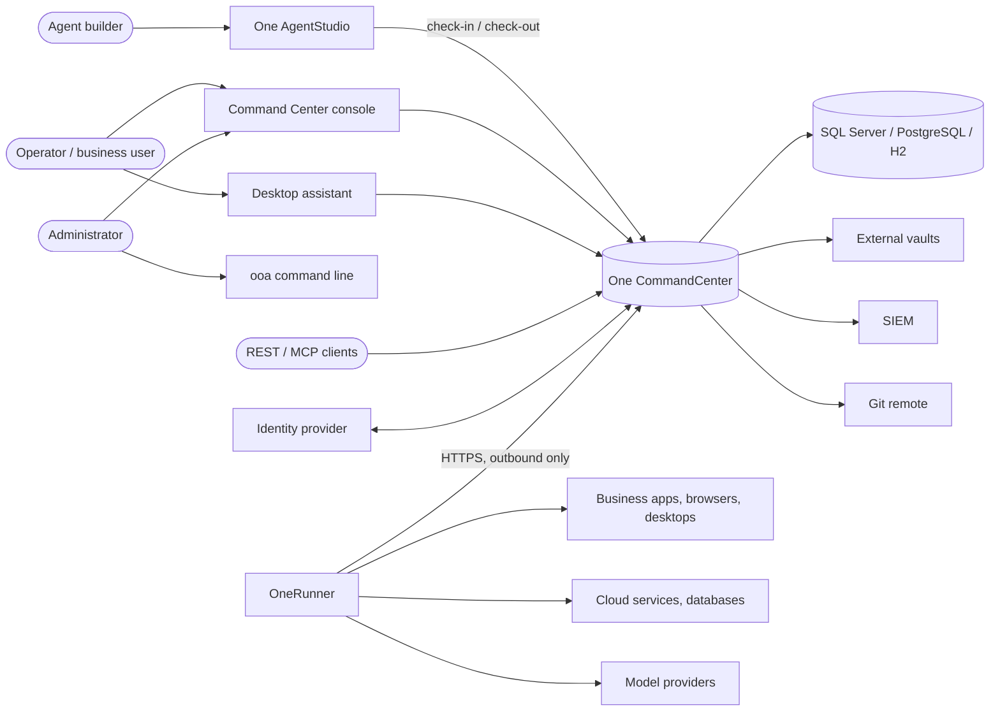
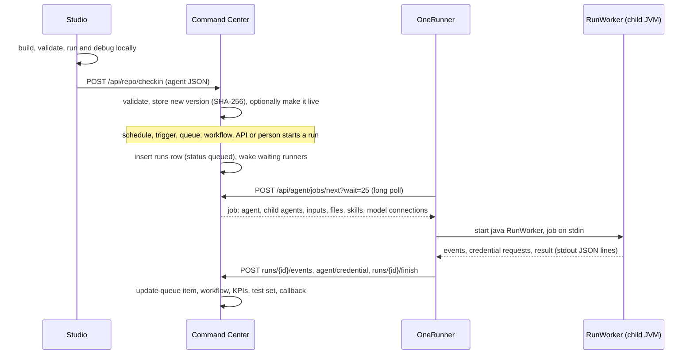
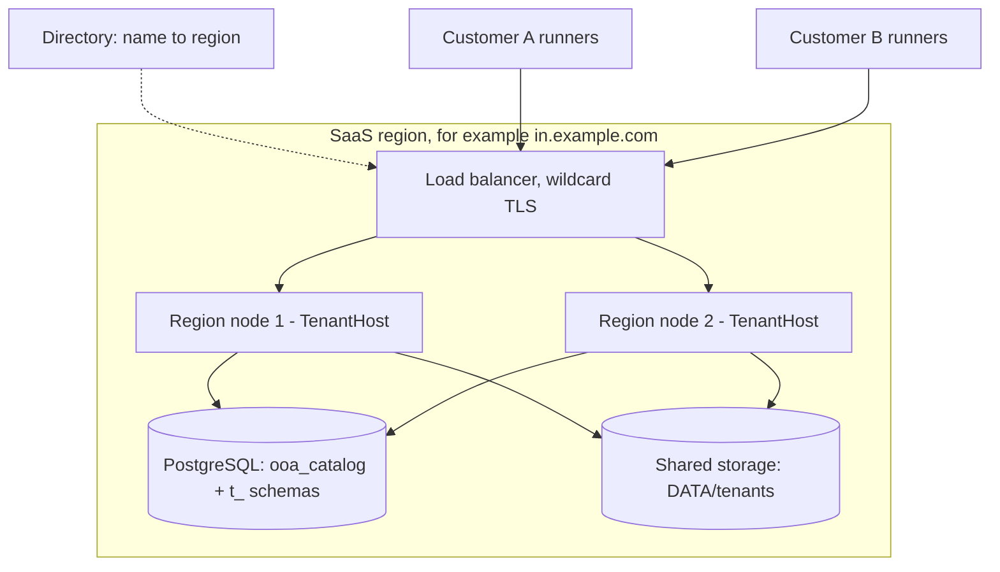

# 01 System overview

## What this covers / who it is for

This document gives the big picture of ONEOFFICEAUTOMATION (OOA): who uses it, which systems it talks to, what its
main parts are and the shapes in which it can be deployed. It is the starting point for architects, technical
pre-sales, security reviewers and new developers. Later documents go deeper into each part; this one names them and
shows how they fit together.

## Contents

1. [Purpose of the platform](#1-purpose-of-the-platform)
2. [System context](#2-system-context)
3. [The main parts](#3-the-main-parts)
4. [How the parts work together](#4-how-the-parts-work-together)
5. [Deployment shapes](#5-deployment-shapes)
6. [Ports, addresses and folders](#6-ports-addresses-and-folders)
7. [Design principles](#7-design-principles)
8. [Related documents](#related-documents)

---

## 1. Purpose of the platform

OOA is an enterprise platform for robotic process automation (RPA) and AI agents. People build **agents** (automations)
in a designer, check them into a shared server, and run them on worker machines, either by hand, on a schedule, when an
event happens, from a work queue, as a step of a workflow, or when another system calls an API. Agents call
**toolkits**: sets of actions for files, Office documents, browsers, desktop applications, databases, cloud services,
mainframe terminals and language models.

The platform is written in Java 21, has no application framework, and keeps its third-party libraries in optional
modules. It runs on a single laptop, on an on-premises server with many runners, on several server nodes sharing one
database, in containers, or as a multi-tenant service in several regions.

## 2. System context

### 2.1 People

| Role | What they do | Main part they use |
| --- | --- | --- |
| Agent builder (developer, citizen developer) | Designs, tests and debugs agents, forms, workflows and Prompt Skills; checks them in | One AgentStudio |
| Agent operator | Starts agents, watches runs, works on work-queue items | Command Center console, desktop assistant |
| Business user | Completes human tasks and approvals in workflows; starts agents they are allowed to run | Task inbox, desktop assistant |
| Administrator | Manages people, roles, runners, vault, settings, licences, toolkits, model connections | Command Center console, `ooa` command line |
| Auditor / security officer | Reads the audit trail, checks its integrity, reviews AI usage | Command Center console, syslog/SIEM |
| SaaS operator | Creates and manages tenants and shared templates in a region | `ooa region` commands, operator API |

### 2.2 Other systems

| System | Direction | Used for |
| --- | --- | --- |
| Business applications (web, desktop, mainframe, SAP GUI) | Runner to application | What agents automate |
| Cloud services (Microsoft 365, Google Workspace, Salesforce, ServiceNow, Jira, Slack, Workday, GitHub, AWS and others) | Runner to service (HTTPS) | Toolkit actions |
| Databases (any JDBC source) | Runner to database | The Database toolkit |
| Language model providers (OpenAI, Azure OpenAI, Anthropic, OpenAI-compatible, Hugging Face, Amazon Bedrock and SageMaker, Google Vertex AI) | Runner to provider | AI actions, AI agents, Prompt Skills |
| Identity provider (OpenID Connect or SAML 2.0) | Browser and Command Center to provider | Single sign-on |
| External vaults (HashiCorp Vault KV v2, Azure Key Vault, AWS Secrets Manager, CyberArk CCP) | Command Center to vault | Credentials read at the moment of use |
| Key stores for the master key (Azure Key Vault, AWS Secrets Manager, Google Secret Manager) | Command Center at start | The vault master key |
| Mail servers (IMAP, Microsoft Graph, SMTP) | Command Center to mail | Mail triggers, licence and notification mail |
| SIEM (syslog RFC 5424) | Command Center to collector | Audit forwarding |
| Git server | Command Center to remote | Read-only mirror of the agent repository |
| AI assistants and other clients (MCP, REST) | Client to Command Center | Starting agents, reading results |
| SQL Server, PostgreSQL | Command Center to database | The Command Center's own data |

### 2.3 Context diagram

## 3. The main parts

| Part | Module | Purpose |
| --- | --- | --- |
| **One CommandCenter** | `control-room` | The shared server. Holds the agent repository with versions and the live production version, users, roles, teams, the vault, runners and pools, schedules, triggers, work queues, workflows and the task inbox, Agent APIs, dashboards, the audit trail and AI governance. Serves the web console (`cr.js`) and the REST API under `/api/`. |
| **One AgentStudio** | `cli` (`StudioServer`, `studio.js`) | The designer. Edits agents and other items in a private folder (My Workspace), validates them, runs and debugs them on the same computer, records and captures web and desktop elements, and checks items in and out of the Command Center. Answers only browsers on the same computer. |
| **OneRunner** | `agent` (`Agent`, `RunWorker`) | The worker on each machine. Registers once with a one-time key, sends a heartbeat every 10 seconds, waits for work with a long poll, and runs each job in its own Java process. Also watches the machine for runner-side triggers. |
| **Runner engine** | `runner` (`Runner`) | The interpreter for an agent definition. Used by Studio, by every run worker and, for serverless Agent APIs, inside the Command Center. |
| **Toolkits** | `packages` and the optional `packages-*` modules | 79 toolkits with 1,057 actions, 47 conditions and 12 loop types, the AWS EC2 toolkit (`ooa.aws_ec2`) included. The [toolkit reference](../reference/toolkits/README.md) lists them all. |
| **Browser connector** | `browser-extension`, `NativeHost`, `ExtensionBridge` | Lets agents and Studio work in the person's own Edge, Chrome or Firefox tabs instead of a browser started by Playwright. |
| **Assistants** | Studio AI assistant (`assistant/build`), desktop assistant (`ooa assistant`) | The Studio assistant drafts agents from a description using the toolkit manifests. The desktop assistant sits in the Windows notification area, starts agents for the signed-in person and tells them about tasks and finished runs. |
| **Command line** | `cli` (`OoaCli`, `CoreCommands`, `FullCommands`) | `ooa` starts servers and runners and manages the database, HTTPS, services, backups, toolkits, regions and licences. A GraalVM native executable carries the commands that need no server. |
| **Vendor tools** | `vendor-tools` | License Studio and licence issuing. In the vendor build only; the customer build leaves this jar out. |
| **Python reference runner** | `reference/` | The earlier reference implementation of the runner, SDK and agent runtime. It is a design source and is not shipped; it passes the same conformance cases as the Java runner. |

## 4. How the parts work together

### 4.1 From design to production run

### 4.2 Key rules that shape the design

- **Runners connect out.** A runner never listens for the Command Center. It asks for work, sends events and fetches
  credentials over HTTP(S). This lets runners sit behind firewalls and in customers' networks, including for the SaaS
  service.
- **Every run gets its own process.** A crashing agent or toolkit cannot stop the runner (`RunWorker`).
- **Production runs use the live version.** Schedules, triggers, queues, workflows and Agent APIs run the version marked
  as production, never a draft.
- **Secrets arrive just in time.** The job carries vault references, not values. The worker asks for a value when a
  step needs it, and the Command Center checks that the run's user may consume that vault folder.
- **Same engine everywhere.** Studio, the runners and serverless Agent APIs all use the same `Runner` class.

## 5. Deployment shapes

| Shape | How it is started | What runs where | Typical use |
| --- | --- | --- | --- |
| **Single computer** | `ooa server` (or `scripts\start-ooa.bat`) | Command Center at `/`, Studio at `/studio/` and a local runner, all in one Java process on port 8720; embedded H2 database | Evaluation, personal automation, development |
| **On-premises server plus runners** | `ooa control-room` (often as a Windows service: `ooa service install`), `ooa agent register` / `ooa agent start` on each runner | One CommandCenter on a server with SQL Server or PostgreSQL; runners on desktops, VDI or servers; Studio on developers' machines | The usual enterprise install |
| **Several nodes** | Two or more Command Centers with the same database and master key behind a load balancer | Every node serves console, API and runners; one leader node runs background work (lease in `cluster_lease`) | High availability; disaster recovery with a standby site |
| **Container** | `docker/Dockerfile` (base `eclipse-temurin:21-jre-jammy`, user `ooa`, volume `/data`, port 8720); `docker/compose.yaml` with SQL Server 2022 | Command Center in a container; runners on Windows machines outside | Cloud or Kubernetes hosting of a single organisation |
| **Multi-tenant SaaS** | `ooa region start` per region, optional `ooa directory start` | One region serves many tenants on one port, each with its own PostgreSQL schema, data folder and vault key; customers' runners connect out to `https://<tenant>.<region-domain>` | The hosted service in India, US and EU regions |

The Linux service unit `platform/linux/ooa-command-center.service` runs the Command Center under systemd. The
customer setup scripts in `platform/customer-setup` and the MSI install the Command Center or a runner on Windows.

## 6. Ports, addresses and folders

| Item | Default | Changed with |
| --- | --- | --- |
| Command Center port | 8720 | `--port` |
| Bind address | 127.0.0.1 for `control-room` unless `--host 0.0.0.0`; `0.0.0.0` for a service made by the setup package or the MSI | `--host`; `-ListenAddress` / `LISTEN_ADDRESS` in the installers |
| Studio when started alone | 127.0.0.1:8710 | `ooa studio --port` |
| Studio inside `ooa server` | `http://localhost:8720/studio/` (loopback callers only) | – |
| Internal plain-HTTP listener when HTTPS is on | 127.0.0.1, random port, for the machine's own runner and Studio | – |
| Health checks | `/api/health`, `/api/health/ready`; `/healthz` on a region's own address | – |
| Command Center data folder | `%USERPROFILE%\OOA Command Center` (or the older `OOA Control Room` folder when it holds a database) | `--data` |
| My Workspace | `%USERPROFILE%\OOA Workspace` | `--workspace` |
| Runner workspace and logs | `%USERPROFILE%\OOA Agent Workspace` | `--workspace` on `agent start` |
| Database settings | `config\ooa-db.properties` in the data folder | `ooa db configure` |
| HTTPS settings | `config\ooa-tls.properties` | `ooa tls` |

## 7. Design principles

- **Plain Java, few dependencies.** The core modules (`sdk`, `runner`) have no third-party libraries. HTTP uses the
  JDK's `HttpServer` and `HttpClient`; crypto uses the JDK only. Heavy libraries (POI, PDFBox, Playwright, JNA, Angus
  Mail, Commons Net) sit in optional modules.
- **One contract for toolkits.** A toolkit's annotations produce its manifest, and every consumer (Studio panels, the
  validator, the AI assistant, the Command Center's toolkit page, MCP) reads that manifest.
- **Determinism and evidence.** Each run reports a plan hash over the agent, its inputs and the toolkit versions; each
  checked-in version carries a SHA-256; the audit trail is a keyed hash chain.
- **Secure by default.** Loopback-only Studio, CSRF header on cookie sessions, strict Content-Security-Policy, secrets
  never returned to the browser, vault values bound to their location.
- **Same code on premises and in SaaS.** A tenant runs the same Command Center code; isolation comes from a separate
  database schema, folder and key per tenant.
- **Architecture rules are tested.** `cli/src/test/.../ArchitectureTest.java` fails the build when a module imports
  what it must not (see [02-components-and-modules.md](02-components-and-modules.md)).

## Related documents

- [README.md](README.md) – index of this collection
- [02-components-and-modules.md](02-components-and-modules.md) – modules, dependencies, technology stack
- [03-agent-model-and-runner.md](03-agent-model-and-runner.md) – the agent format and the engine
- [04-command-center-internals.md](04-command-center-internals.md) – inside the Command Center
- [05-data-model.md](05-data-model.md) – database tables
- [06-security-architecture.md](06-security-architecture.md) – security design
- [07-toolkit-architecture.md](07-toolkit-architecture.md) – toolkits
- [08-ai-architecture.md](08-ai-architecture.md) – AI features
- [09-multi-tenant-saas-and-regions.md](09-multi-tenant-saas-and-regions.md) – SaaS
- [10-extensibility-and-integration.md](10-extensibility-and-integration.md) – integration points
