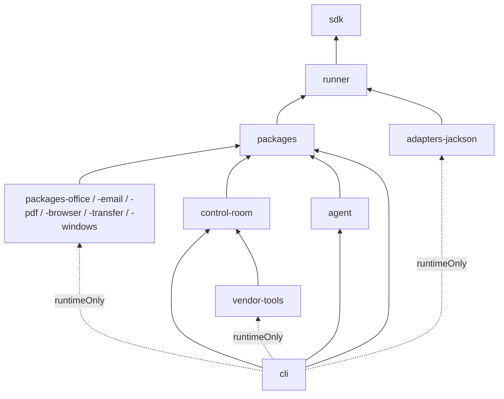

# 02 Components and modules

## What this covers / who it is for

This document maps the product onto its source code. It lists every Gradle module under `platform/`, what each
contains, which modules depend on which, how optional modules are switched on and off, the third-party libraries in
use and why the stack looks the way it does. It is for developers joining the project, reviewers judging the supply
chain, and architects planning changes to the module structure.

## Contents

1. [Repository layout](#1-repository-layout)
2. [The Gradle build](#2-the-gradle-build)
3. [Module catalogue](#3-module-catalogue)
4. [Dependencies between modules](#4-dependencies-between-modules)
5. [Optional modules](#5-optional-modules)
6. [Toolkit inventory by module](#6-toolkit-inventory-by-module)
7. [Technology stack and reasons](#7-technology-stack-and-reasons)
8. [Builds and distributions](#8-builds-and-distributions)
9. [Front ends](#9-front-ends)
10. [Related documents](#related-documents)

---

## 1. Repository layout

```
oneofficeautomation/
├─ platform/                    the Java product (all modules)
│  ├─ settings.gradle.kts       fixed modules + optional modules from gradle.properties
│  ├─ gradle.properties         ooa.optionalModules=...
│  ├─ build.gradle.kts          shared settings for every module: Java 21, JUnit 5, version 0.2.0
│  ├─ gradle/libs.versions.toml version catalog (Jackson, networknt, JUnit)
│  ├─ sdk/ runner/ packages/ packages-*/ adapters-jackson/
│  ├─ control-room/ agent/ cli/ vendor-tools/
│  ├─ browser-extension/        Edge/Chrome/Firefox extension (plain JavaScript)
│  ├─ docker/                   Dockerfile, compose.yaml, compose.saas.yaml, entrypoint
│  ├─ linux/                    systemd unit for the Command Center
│  ├─ customer/                 START-OOA.cmd and README.txt for the customer zip
│  ├─ customer-setup/           Install.cmd, Install-OOA.ps1, Uninstall-OOA.ps1
│  └─ scripts/                  start-ooa.bat, desktop shortcut, runner task, License Studio launcher
├─ contracts/
│  ├─ flow-schema/flow.v1.json  JSON Schema of an agent definition
│  └─ conformance/cases/        18 language-neutral runner test cases
├─ reference/                   Python reference runner, SDK and agent runtime (not shipped)
├─ examples/                    sample agents
└─ docs/                        documentation (this collection is docs/architecture)
```

## 2. The Gradle build

- `settings.gradle.kts` always includes `sdk`, `runner`, `packages`, `adapters-jackson`, `control-room`, `agent`, `cli`
  and `vendor-tools`. It then includes every module named in the `ooa.optionalModules` property.
- `build.gradle.kts` applies `java-library` to every subproject, sets `group = com.oneofficeautomation` and
  `version = 0.2.0`, uses a Java 21 toolchain with `--release 21`, UTF-8 sources and JUnit 5.10.3.
- Tests tagged `load` run only through `gradlew :cli:loadTest`.
- Tests can run against SQL Server or PostgreSQL instead of H2 with `-Pooa.test.db=...`, `-Pooa.test.db.user` and
  `-Pooa.test.db.password`; each test data folder then gets its own `ooa_t_*` database.
- System properties `ooa.contracts` and `ooa.examples` point the tests at `contracts/` and `examples/`.

## 3. Module catalogue

| Module | Main contents | Third-party libraries |
| --- | --- | --- |
| `sdk` | The contract for toolkits. Annotations `@OoaPackage`, `@Action`, `@Input`, `@Output` (repeatable via `Outputs`), `@Condition`, `@LoopIterator`; `ActionContext` (what an action sees); `OoaType` (13 data types); `SecureString`; `OoaException` and `ActionException`; `ActionSpec` and `PackageIntrospector` (manifest from annotations, panel layout parsing); `PackageRegistry` (installed toolkits, versions, publisher trust); `PackageSigning` (Ed25519); `ToolkitJar` (signed custom toolkit jars); `FieldLabels` (plain-English labels from field names); `ChildAgents`; `JsonLite` (JSON parse/write/canonical form); `SchemaTypes`; `BuildInfo` (the product version, generated at build time from the root `build.gradle.kts`) | none |
| `runner` | `Runner` (the engine), `CorePackage` (the `core/*` actions), `expr/Expressions` and `expr/Functions` (sandboxed expression language), `FlowValidator`, `Conditions`, `ErrorCodes`, `Steps`, `Values`, `RunEvent`, `RunResult`, `JavaArgs`; interfaces `CredentialVault`, `AutomationRepository`, `BotInvoker`, `EventSink`, `FlowSchemaValidator`, `JsonCodec` | none |
| `packages` | The built-in toolkits (see section 6) and shared helpers: `HttpJson` and `HttpOptions` (HTTP for cloud toolkits), `LlmClient`, `ModelConnections`, `ModelProbe`, `AiBridge` (model access for other modules), `AwsSigV4`, `EnterpriseAuth`, `ConnectorImporter`/`ConnectorStore` (custom connectors), `XmlSupport` (hardened XML), `JsonSchemaLite`, `ProcessRunner`, `DesktopSupport`, `UiGuard`, `FormWindow`, `Wsdl`, `ZipCrypt`, `SnmpV3`, `VtScreen`/`VtSshSession`, `FirstPartyPackages` (the registry list) | JSch 0.2.20 (VT terminal over SSH) |
| `packages-office` | Excel, Word and PowerPoint without Microsoft Office; `OfficeCrypto`, `Msip` (sensitivity labels), `DocumentText` | Apache POI 5.3.0 (ooxml, scratchpad) |
| `packages-email` | Email over SMTP and IMAP, with OAuth | Eclipse Angus Mail 2.0.3 |
| `packages-pdf` | PDF | Apache PDFBox 3.0.3 |
| `packages-browser` | Browser automation and recorder; `WebObjects` (captured object matching), `BrowserWindows`, `ExtensionBridge` (browser connector), `ObjectRecorder`; the web goal agent `WebAgentPackage` | Microsoft Playwright 1.47.0 |
| `packages-transfer` | FTP, FTPS, SFTP | Apache Commons Net 3.11.1, JSch 0.2.20 |
| `packages-windows` | Window control, DLL calls, Windows Credential Manager, desktop objects through UI Automation (`DesktopObject`, `UiaBridge`), Java applications (Swing/AWT), hotkeys | JNA platform 5.14.0 |
| `adapters-jackson` | `JacksonJsonCodec`, `NetworkntFlowSchemaValidator` (JSON Schema validation of agents against `flow.v1.json`) | Jackson 2.17.2, networknt json-schema-validator 1.4.0 |
| `control-room` | One Command Center. Core services `ControlRoom` and `Platform`; `ControlRoomServer` (HTTP API and console); `Db`, `DbConfig`, `SqlServerDialect`; security (`Security`, `Rbac`, `Folders`, `Mfa`, `Sso`, `Saml`, `RateLimiter`, `IpAllowList`, `TlsConfig`, `NetGuard`); vault (`Vault`, `VaultAdmin`, `ExternalVaults`, `KeySources`); `Audit` and `SyslogForwarder`; automation (`TriggerKinds`, `TriggerPollers`, `ImapMailSource`, `GraphMailSource`, `PollHttp`, `JsonPath`, `Workflows`, `ApiTasks`, `ServerlessRuns`); repository (`RepoFiles`, `ProductionApproval`, `CodeAnalysis`, `Lifecycle`, `GitSync`, `Templates`, `TestSets`); `PromptSkills`, `McpServer`, `Analytics`, `Dashboards`, `Teams`, `Backups`, `Mailer`, `RunnerUpdates`, `CustomToolkits`, `Cluster`; licensing (`License`, `Licensing`); SaaS (`Tenants`, `TenantHost`, `RegionConfig`, `RegionDirectory`). Console UI in `src/main/resources/console` (`index.html`, `cr.js`, `cr.css`) | POI 5.3.0 (spreadsheet import/export), JGit 6.10 (Git mirror); runtime JDBC drivers H2 2.2.224, PostgreSQL 42.7.4, mssql-jdbc 12.8.1 |
| `agent` | One Runner. `Agent` (register, heartbeat, long poll, run jobs), `RunWorker` (the child process that runs one job), `AgentClient` (HTTP with device id and secret), `LocalTriggers` (machine events), `DesktopSession` (screen state, lock, sign-out), `Network` (proxy and certificate trust), `Updater` and `UpdateHelper` (self-update), `Diagnose` (`ooa agent diagnose`) | JNA platform 5.14.0 |
| `cli` | The `ooa` program. `Ooa` and `OoaCli` (picocli command tree), `CoreCommands` and `FullCommands`, `OoaNative` (GraalVM entry point); `StudioServer` (Studio API), `Workspace` (My Workspace files), `ControlRoomLink` (check-in and check-out), `StudioDebugger`, `RunWindow`, `TriggerService` (Studio's local triggers), `EnvVault` (development vault from environment variables); `Assistant`/`AssistantClient` (desktop assistant); `NativeHost` and `BrowserConnector` (browser connector host and install); `DbCommand`, `TlsCommand`, `BackupCommand`, `WindowsService`, `ToolkitCommand`, `LicenseCommand`, `ReleaseCommand`, `ReleasePage`, `RegionCommand`, `CheckCommand`. Studio UI in `src/main/resources/studio` (`index.html`, `studio.js`, `studio.css`) | picocli 4.7.6, JNA 5.14.0, Logback 1.5.8 (runtime) |
| `vendor-tools` | `LicenseStudio` (local web page for issuing licences) and `VendorLicenseTools` (`ooa license keygen`, `issue`, `ui`); its jar carries the marker `META-INF/ooa-vendor` | none |

Sizes at the time of writing (main Java code only, physical lines; many lines are long): `runner` about 2.7k,
`sdk` about 1.2k, `agent` about 1.4k, `cli` about 5.1k, `control-room` about 14.7k. The two UIs are large single
JavaScript files: `studio.js` about 6,000 lines and `cr.js` about 3,300 lines.

## 4. Dependencies between modules



The rules are enforced by `cli/src/test/java/com/oneofficeautomation/cli/ArchitectureTest.java`:

| Test | Rule |
| --- | --- |
| `moduleBoundaries` | `sdk` imports no other OOA module. `runner` imports neither toolkits, Studio, the Command Center nor the runner service. Built-in `packages` never import Studio or optional modules. Each optional module imports only the SDK, the runner, built-in packages and itself. `cli` never imports optional modules directly (it loads them by class name). `control-room` imports neither `cli` nor `agent`. `agent` imports neither `cli` nor `controlroom`: it talks to the Command Center only over HTTP. |
| `noShellExecutionAnywhere` | No `Runtime.exec`, no `cmd /c`, `sh -c` or `bash -c`: programs start with argument lists. |
| `xmlParsingOnlyThroughTheHardenedParser` | All XML parsing in toolkits goes through `XmlSupport`, which blocks external entities. |
| `controlRoomUsesOnlyParameterisedSql` | Command Center SQL is built from constants and `?` placeholders only. |
| `packagesNeverPrintToTheConsole` | Toolkits log through `ActionContext`, so secrets are masked. |
| `everyCommandIsDocumentedAndConsistentlyNamed` | First-party toolkit ids start with `ooa.` (except `core`), every toolkit and action has a description, ids are snake case. |

## 5. Optional modules

`platform/gradle.properties`:

```properties
ooa.optionalModules=packages-office,packages-email,packages-pdf,packages-browser,packages-transfer,packages-windows
```

- A module removed from the list is not built. The rest of the platform still builds and runs; the toolkits of that
  module disappear from Studio until it is restored.
- `cli` declares each listed module as `runtimeOnly`, so it is on the class path at run time but never referenced at
  compile time.
- `FirstPartyPackages.OPTIONAL` names the optional toolkit classes as strings. `FirstPartyPackages.registry()` tries
  `Class.forName` for each and skips the ones that are missing (`ClassNotFoundException` or `LinkageError`).
- Each runner reports the toolkits it has (`id@version`) in its heartbeat. The Command Center refuses to send a job to
  a runner that lacks a toolkit the agent uses (`RUN.TOOLKIT_MISSING`), except custom toolkits, which travel with the
  job.

## 6. Toolkit inventory by module

| Module | Toolkits (id) |
| --- | --- |
| `runner` | `core` |
| `packages` – data | `ooa.string`, `ooa.number`, `ooa.boolean`, `ooa.datetime`, `ooa.list`, `ooa.dictionary`, `ooa.datatable`, `ooa.json`, `ooa.xml`, `ooa.csv`, `ooa.currency`, `ooa.fuzzy` |
| `packages` – files and system | `ooa.file`, `ooa.folder`, `ooa.log`, `ooa.system`, `ooa.application`, `ooa.script`, `ooa.services`, `ooa.printer`, `ooa.sound`, `ooa.network`, `ooa.run_context`, `ooa.global_values` |
| `packages` – integration | `ooa.rest`, `ooa.soap`, `ooa.database`, `ooa.connector` (custom connectors), `ooa.kafka` |
| `packages` – security | `ooa.crypto`, `ooa.pgp`, `ooa.active_directory` |
| `packages` – desktop and screen | `ooa.desktop`, `ooa.image`, `ooa.ocr`, `ooa.excel_desktop`, `ooa.outlook_desktop`, `ooa.interrupts`, `ooa.forms`, `ooa.terminal`, `ooa.sap` |
| `packages` – cloud applications | `ooa.microsoft365`, `ooa.google`, `ooa.salesforce`, `ooa.servicenow`, `ooa.jira`, `ooa.slack`, `ooa.workday`, `ooa.github`, `ooa.azure_devops`, `ooa.asana`, `ooa.zendesk`, `ooa.okta`, `ooa.box`, `ooa.docusign`, `ooa.snowflake`, `ooa.databricks`; `ooa.aws_ec2` (AWS EC2: sessions, describe instances and status, start/stop/reboot/terminate, monitoring, launch, tags, wait for state; signed with AWS Signature V4, no AWS SDK) |
| `packages` – work management and AI | `ooa.workload` (work queues), `ooa.insights`, `ooa.triggerloop`, `ooa.genai`, `ooa.ai_skills`, `ooa.ai_agent`, `ooa.knowledge` |
| `packages-office` | `ooa.excel`, `ooa.word`, `ooa.powerpoint` |
| `packages-email` | `ooa.email` |
| `packages-pdf` | `ooa.pdf` |
| `packages-browser` | `ooa.browser`, `ooa.web_agent` |
| `packages-transfer` | `ooa.file_transfer` |
| `packages-windows` | `ooa.window`, `ooa.dll`, `ooa.desktop_ui`, `ooa.java_apps`, `ooa.credential_manager` |

Counted from the annotations in the code: 78 toolkits, 1,044 actions, 47 conditions and 12 loop iterators, before
`ooa.aws_ec2`. `docs/COMMAND_CATALOG.md` lists every action.

## 7. Technology stack and reasons

| Layer | Choice | Reason |
| --- | --- | --- |
| Language | Java 21 (records, sealed interfaces, pattern matching, virtual threads) | One language for server, runner and toolkits; long-term support; virtual threads make long polls cheap |
| Build | Gradle with Kotlin DSL and the wrapper; version catalog | Multi-module build with optional modules chosen by a property |
| HTTP server | JDK `com.sun.net.httpserver.HttpServer` / `HttpsServer` | No framework to patch; small, fast start; easy to embed Studio under `/studio` |
| HTTP client | JDK `java.net.http.HttpClient` (wrapped by `HttpJson`) | Every cloud toolkit calls REST APIs directly instead of pulling in vendor SDKs |
| Command line | picocli 4.7.6, commands declared in code | Help, validation and completion; no reflection, so it compiles to a native executable |
| JSON | Own `JsonLite`; Jackson and networknt only in `adapters-jackson` | The core has no third-party JSON dependency; schema validation is optional |
| Database access | Plain JDBC, own pool and migrations in `Db`; `SqlServerDialect` translates portable SQL | Same code on H2, PostgreSQL and SQL Server; no ORM |
| Databases | SQL Server 2019+, PostgreSQL 14+, H2 2.2 embedded | Customers' standard databases; H2 for evaluation and tests |
| Crypto | JDK only: PBKDF2-HMAC-SHA256, AES-256-GCM, HMAC-SHA256, Ed25519, RSA/EC signature checks | No crypto libraries to keep up to date |
| Office, PDF, mail, browser, FTP, Windows | POI, PDFBox, Angus Mail, Playwright, Commons Net/JSch, JNA | Mature open-source libraries, kept in optional modules |
| Git mirror | Eclipse JGit | Pure Java Git client |
| Logging | SLF4J with Logback at run time in `cli` | Standard, configurable |
| Front ends | Plain JavaScript, HTML and CSS, no build step | Served from the jars; works offline; nothing to compile |
| Tests | JUnit 5.10; Node.js with jsdom for the two UIs | Fake local HTTP servers for every cloud toolkit |
| Native executable | GraalVM for JDK 21 (`gradlew :cli:nativeExecutable`) | Instant start for build pipelines (`validate`, `run`, `manifest`, `conformance`, `license show`, `release verify`) |
| Container base | `eclipse-temurin:21-jre-jammy` | Supported JRE image |

New third-party libraries must have a permissive licence (Apache-2.0, MIT or similar) and, when heavy, go into an
optional module.

## 8. Builds and distributions

| Output | Task | Holds |
| --- | --- | --- |
| Developer run | `gradlew :cli:run --args="server"` | Everything, from source |
| Full install (vendor build) | `gradlew :cli:installDist` → `cli/build/install/ooa` | Product plus `vendor-tools` |
| Customer zip | `gradlew :cli:customerDistZip` → `ooa-customer-<version>.zip` | Product without `vendor-tools`; `START-OOA.cmd`, `README.txt` |
| Native executable | `gradlew :cli:nativeExecutable` → `cli/build/native/ooa(.exe)` | Commands that need no Command Center; runs only built-in toolkits (others stop with `ACTION.NOT_IN_THIS_PROGRAM`) |
| SBOM | `gradlew :cli:sbom` | CycloneDX bill of materials, also inside each package as `sbom.cdx.json` |
| Container image | `docker/Dockerfile` | Command Center image, entrypoint `docker-entrypoint.sh` |
| Release manifest | `ooa release sign` (vendor) / `ooa release verify` | Ed25519-signed list of release files with SHA-256 |

## 9. Front ends

| UI | File | Served from | Notes |
| --- | --- | --- | --- |
| Command Center console | `control-room/src/main/resources/console/cr.js` | `/` on the Command Center | Pages registered in `PAGES` and `VIEWS`; helpers `h()`, `header()`, `dataTable()`, `modal()`, `openDrawer()`, `tabStrip()`; live updates by a long request to `/api/changes` |
| One Agent Studio | `platform/ui` (TypeScript and React, built into the CLI) | `/studio/` inside `ooa server`, or `ooa studio` on port 8710 | Automation page, agent steps (list or flow), Actions panel by toolkit family, settings panels built from manifests (`x-ooa-panel`), debugger, output panel, capture and record |
| Browser extension | `browser-extension/background.js`, `content.js` | Loaded unpacked or by policy | Manifest V3 for Edge/Chrome, `manifest.firefox.json` for Firefox |

## Related documents

- [README.md](README.md)
- [01-system-overview.md](01-system-overview.md)
- [03-agent-model-and-runner.md](03-agent-model-and-runner.md)
- [04-command-center-internals.md](04-command-center-internals.md)
- [05-data-model.md](05-data-model.md)
- [06-security-architecture.md](06-security-architecture.md)
- [07-toolkit-architecture.md](07-toolkit-architecture.md)
- [08-ai-architecture.md](08-ai-architecture.md)
- [09-multi-tenant-saas-and-regions.md](09-multi-tenant-saas-and-regions.md)
- [10-extensibility-and-integration.md](10-extensibility-and-integration.md)
