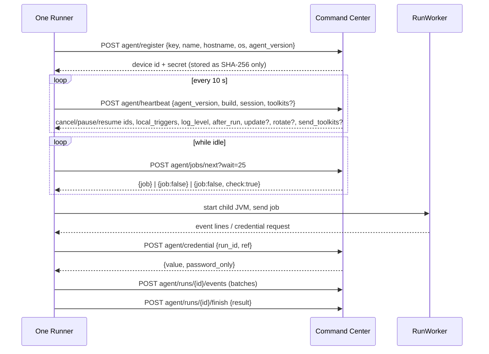

# 04 Command Center internals

## What this covers / who it is for

This document opens up One Command Center (module `control-room`): how the server is started, how a request is
handled, which API families exist (REST for people and programs, the runner API with long polling, webhooks, API
tasks, MCP), the background clock (schedules, triggers, work queues, workflows, housekeeping), how runs are dispatched
to runners and pools, serverless runs, the leader lease for several nodes, and how runner updates are distributed. It
is for developers changing the Command Center and for architects sizing or clustering it.

## Contents

1. [Main classes](#1-main-classes)
2. [Server start-up](#2-server-start-up)
3. [Request handling](#3-request-handling)
4. [API families](#4-api-families)
5. [Runs: from request to runner](#5-runs-from-request-to-runner)
6. [The runner protocol](#6-the-runner-protocol)
7. [The background clock](#7-the-background-clock)
8. [Schedules and triggers](#8-schedules-and-triggers)
9. [Work queues](#9-work-queues)
10. [Workflows and human tasks](#10-workflows-and-human-tasks)
11. [API tasks and serverless runs](#11-api-tasks-and-serverless-runs)
12. [Several nodes and the leader lease](#12-several-nodes-and-the-leader-lease)
13. [Runner updates](#13-runner-updates)
14. [Repository services](#14-repository-services)
15. [Settings](#15-settings)
16. [Related documents](#related-documents)

---

## 1. Main classes

| Class | Responsibility |
| --- | --- |
| `ControlRoom` | Core services: users and sessions, repository (check-in/out, versions, labels, folders, delete/recover), runners (registration, heartbeat, secrets), runs (start, claim, events, finish, control), schedules, triggers, vault folders and credentials, shared values, saved connections, audit search, dashboard |
| `Platform` | Settings (`DEFAULTS`), custom roles, API keys, runner pools, work queues and item models, model connections, holiday calendars, toolkit switches, AI governance, retention purges, outbound proxy |
| `ControlRoomServer` | HTTP server, static files, routing of `/api/*`, cookies, security headers, background clock |
| `Db`, `DbConfig`, `SqlServerDialect` | Database pool, transactions, migrations, dialect translation (see [05-data-model.md](05-data-model.md)) |
| `Workflows` | One Workflow engine and the task inbox |
| `TriggerKinds`, `TriggerPollers`, `ImapMailSource`, `GraphMailSource`, `PollHttp`, `JsonPath` | Trigger definitions and server-side polling |
| `ApiTasks`, `ServerlessRuns` | Agents behind their own URL; agents run inside the server |
| `McpServer` | Model Context Protocol endpoint |
| `Cluster` | Leader lease and shared short-lived state for several nodes |
| `RunnerUpdates` | Program files offered to runners |
| `Audit`, `SyslogForwarder` | Audit chain, checkpoints, SIEM forwarding |
| `Vault`, `VaultAdmin`, `ExternalVaults`, `KeySources` | Credentials and the master key |
| `Licensing`, `License` | Licence state and seats |
| `RepoFiles`, `ProductionApproval`, `CodeAnalysis`, `Lifecycle`, `GitSync`, `Templates`, `TestSets`, `PromptSkills`, `CustomToolkits` | Repository features |
| `Analytics`, `Dashboards`, `Teams`, `Folders`, `Backups`, `Mailer` | Operations features |
| `Tenants`, `TenantHost`, `RegionConfig`, `RegionDirectory`, `NetGuard` | SaaS (see [09-multi-tenant-saas-and-regions.md](09-multi-tenant-saas-and-regions.md)) |

Every service method that a person can reach starts with `cr.require(user, "<permission>", "<what>")`, uses
parameterised SQL and records an audit entry.

## 2. Server start-up

`ooa control-room` (or `ooa server`, which also mounts Studio and starts a local runner) does, in order:

1. Opens the data folder and the vault (`Vault`: `OOA_MASTER_KEY`, `OOA_MASTER_KEY_SOURCE`, or `master.key`).
2. Opens the database from `config/ooa-db.properties` (`DbConfig`), or the embedded H2 file `controlroom.mv.db`.
3. Runs migrations up to `Db.LATEST` (24). On SQL Server or PostgreSQL the runtime account may not change tables, so a
   newer schema stops start-up with `CR.DB_UPGRADE_NEEDED` until `ooa db migrate` runs with the setup account. A
   database newer than the program gives `CR.DB_NEWER`.
4. Builds the toolkit registry (`FirstPartyPackages.registry()` plus trusted custom toolkits).
5. Creates the first administrator with a one-time password on a new database (`bootstrap`).
6. Starts `ControlRoomServer`: `HttpServer`, or `HttpsServer` with TLS 1.3 and 1.2 only when
   `config/ooa-tls.properties` is set (`TlsConfig`). A port in use gives `CR.PORT_IN_USE`.
7. With HTTPS on, also opens a plain-HTTP listener on 127.0.0.1 (random port, 4 threads) for this machine's own runner
   and Studio, so they need no certificate trust (`internalUrl()`).
8. Starts the background clock (section 7).

The HTTP executor creates **one virtual thread per request** (`Thread.ofVirtual()`), so hundreds of runners holding
long-poll requests cost almost nothing.

## 3. Request handling

`ControlRoomServer.handle` sends `/api/*` to `api(...)` and everything else to the static console files. Inside
`api(...)` the checks run in this order:

0. **Client address** (`clientIp`): the TCP peer address, or, when the connection comes from this computer or from a
   trusted proxy (setting `trusted_proxies`, addresses or CIDR ranges of load balancers and reverse proxies), the last
   `X-Forwarded-For` address that is not itself a trusted proxy. A client that is not behind a trusted proxy cannot
   choose its address with the header. The allow list, the rate limits and the audit trail all use this address.
1. **IP allow list** (setting `ip_allow_list`, CIDR list): callers whose client address is not this computer and is
   outside the list get 403 `CR.IP_BLOCKED`. Health routes are always allowed. A reverse proxy on the same computer
   does not make remote clients skip the list: their forwarded address counts.
2. **Rate limits** per client address for routes that need no session (`RateLimiter.group`): 429 `CR.RATE_LIMITED`
   with `Retry-After`. A client on this computer without a proxy is not limited.
3. **Public routes**: sign-in (`auth/login`, `auth/mfa`, `auth/token`), SSO (`auth/sso/*`, `auth/saml/*`), API task
   calls (`apitasks/{id}/run`, `apitasks/{id}/runs/{run}`), webhooks (`hooks/{id}`), health (`health`,
   `health/ready`).
4. **Runner routes** (`agent/*`): `agent/register` with a registration key, all others with the `X-OOA-Device` and
   `X-OOA-Device-Secret` headers.
5. **Signed-in routes**: the user comes from the `Authorization: Bearer` header (a session token, an `ooak_` API key,
   or for `/api/mcp` an OAuth JWT from the identity provider) or the `ooa_cr` cookie. Cookie requests that change
   anything must carry `X-OOA-Request: 1` (`CR.CSRF`). A user who must change their password or set up two-step
   sign-in is held back until they do.
6. The route is chosen by its first path segment (`switch (seg[0])`).

Request bodies are limited by the setting `max_upload_mb` (default 25 MB; `CR.TOO_LARGE`). Errors are answered as
`{"error": {code, message, suggestedFix, retryable}}` with a status chosen from the code: 401 for sign-in problems,
403 for permission, CSRF, licence and IP problems, 404 for missing objects, 409 for conflicts and locks, 422 for
code-policy violations, 429 for lock-out and rate limits, 400 otherwise, and 500 `CR.INTERNAL` for unexpected
failures. Every response carries the security headers described in [06-security-architecture.md](06-security-architecture.md).

## 4. API families

### 4.1 People and programs (`/api/...`)

| Area | Route prefixes |
| --- | --- |
| Sign-in and account | `auth/login`, `auth/mfa`, `auth/mfa/{status,setup,enable,disable}`, `auth/token`, `auth/refresh`, `auth/me`, `auth/logout`, `auth/password`, `auth/sso*`, `auth/saml*` |
| Repository | `repo`, `repo/bot`, `repo/checkin`, `repo/checkout`, `repo/undo-checkout`, `repo/versions`, `repo/labels`, `repo/production`, `repo/production-requests`, `repo/folders`, `repo/permissions`, `repo/files`, `repo/move`, `repo/copy`, `repo/delete`, `repo/recover`, `repo/dependencies`, `repo/analyze`, `repo/analysis`, `repo/policy`, `repo/roi` |
| Runs | `runs` (list, start one or many, control, purge), `runs/{id}/ai-calls`, `changes` (live update feed) |
| Runners | `devices`, `devices/registration-key`, `devices/runasusers`, `devices/update`, `pools` |
| Automation | `schedules`, `schedules/bulk`, `triggers`, `calendars`, `queues`, `queues/import`, `queue-models`, `workflows`, `workflows/start`, `workflows/runs`, `workflows/form`, `tasks`, `apitasks`, `test-sets` |
| Vault and values | `lockers`, `vault`, `vault/credential`, `vault/value`, `vault/my-value`, `vault/requests`, `vault/rotate`, `vault/status`, `globals`, `saved-connections`, `connection-kinds` |
| AI | `connections` (model connections), `connections/test`, `skills`, `skills/templates`, `skills/from-template`, `governance`, `mcp` |
| Administration | `users`, `roles`, `teams`, `apikeys`, `settings`, `settings/mail-test`, `settings/syslog-test`, `database`, `toolkits`, `toolkits/custom`, `toolkits/publishers`, `license`, `license/assignments`, `license/usage`, `backups`, `cluster`, `git`, `git/sync`, `git/status`, `audit`, `audit/verify`, `audit/export` |
| Insight | `dashboard`, `dashboards`, `dashboards/kpis`, `analytics`, `analytics/agent`, `analytics/variables`, `analytics/export`, `catalog` |
| Moving agents | `lifecycle`, `lifecycle/export`, `lifecycle/import`, `lifecycle/promote`, `templates`, `templates/catalogue`, `templates/install`, `templates/share` |

The console uses the same API as any client. Its live views keep one request open to `GET /api/changes?since=TOKEN&wait=25`.
The token combines the highest audit sequence number with this node's write counter; a write on this node answers at
once, and writes on other nodes are seen within 2 seconds.

### 4.2 Runner API (`/api/agent/...`)

| Route | Purpose |
| --- | --- |
| `POST agent/register` | Exchange a one-time registration key for a device id and secret |
| `POST agent/heartbeat` | Report status, version, build, screen state, toolkits; receive control instructions |
| `POST agent/jobs/next?wait=N` | Long poll for the next job (N at most 25 seconds) |
| `POST agent/runs/{id}/events` | Append a batch of run events (duplicates by `seq` are ignored) |
| `POST agent/runs/{id}/finish` | Final result, including AI call records |
| `POST agent/credential` | Fetch one vault value for a running job |
| `POST agent/rotate` | Get a new device secret when the heartbeat asks for it |
| `POST agent/trigger-fired`, `agent/trigger-status` | Report a runner-side trigger event or error |
| `GET agent/update/manifest`, `agent/update/file?name=` | Program files for self-update |

### 4.3 Other entry points

| Entry point | Authentication | Notes |
| --- | --- | --- |
| `POST /api/hooks/{trigger id}` | `X-OOA-Secret` header, compared as a SHA-256 hash in constant time | Starts the trigger's agent with the payload; answers 202 |
| `POST /api/apitasks/{id}/run` | `X-OOA-Task-Token` (or Bearer) | Section 11 |
| `POST /api/mcp` | Bearer API key, session, or OAuth JWT | JSON-RPC 2.0; see [08-ai-architecture.md](08-ai-architecture.md) |
| `GET /.well-known/oauth-protected-resource` | none | OAuth protected resource metadata (RFC 9728) for MCP clients |
| `GET /api/health`, `/api/health/ready` | none | Liveness and readiness (503 when not ready) |

## 5. Runs: from request to runner

`ControlRoom.startRun(...)` is the single entry for every run source: a person (`POST /api/runs`), a schedule, a
trigger, a work queue (`queue:<id>`), a workflow (`workflow:<id>`), an API task, MCP (`mcp`), a test set
(`test:<run>`), and serverless runs.

1. Checks the permission (`runs.start`) and folder access, the licence, and that the agent has a live production
   version.
2. Resolves the target: an explicit runner, a pool, or a **run-as user's default runner** (`user_devices`). A pool
   picks its online, enabled runner with the fewest queued and running runs. "Online" means a heartbeat within the last
   60 seconds.
3. Checks the inputs against the agent's declared input variables.
4. Inserts a `runs` row with status `queued`, the version, inputs, requester, run-as user, source, priority, optional
   callback URL and queue item. Starts against several run-as users or runners create one run each (`deploy`).
5. Wakes runners waiting in a long poll (`wake`).

Claiming (`claimNext`) is atomic: the runner's oldest highest-priority `queued` run is switched to `running` with
`UPDATE ... WHERE status = 'queued'`, so two requests never get the same run. Before handing it out the Command Center:

- refuses work to a runner newer than itself (`ControlRoom.VERSION`; runners may be older, never newer). Both
  `ControlRoom.VERSION` and `Agent.VERSION` come from the build: `sdk` generates `BuildInfo` from the `version` in the
  root `build.gradle.kts`, so every part reports the same release;
- re-checks the licence (it may have expired since queueing);
- collects child agents (production versions, transitively), shared values (with the run-as user's own values where
  allowed), the run-as user's role, model connections the role may use, saved connections, repository files listed in
  `requires.files`, Prompt Skills the agents name, and custom toolkit jars;
- checks that the runner has every toolkit used (`RUN.TOOLKIT_MISSING`).

Any failure here fails the run with its reason before it starts.

`finish(...)` stores AI call records first (so whoever waits for the status sees them), then the status, outputs,
error and step count; records the audit entry; updates the work-queue item; dispatches the queue's next item at once on
the leader; records KPIs for successful runs; judges test-set runs; resumes waiting workflows; and posts the optional
callback URL (3 attempts in the background, failures audited).

Run control (`POST /api/runs/{id}` with stop, pause, resume) sets `cancel_requested` or `pause_requested` and asks the
runner to send a heartbeat at once, which carries the instruction back.

## 6. The runner protocol

- The runner waits up to 25 seconds per poll (`Agent.waitSeconds`). The Command Center's `nextJob` re-checks every
  2 seconds while waiting, for work queued on another node or without a wake-up. An older Command Center that answers
  at once makes the runner fall back to polling every 2 seconds.
- A runner takes **one job at a time** and runs it in its own JVM (`RunWorker`), with stderr appended to a log file in
  the runner's workspace.
- `{check: true}` tells the runner to send a heartbeat now (a run of its own was stopped or paused).
- The housekeeping fails runs whose runner has not reported for **2 minutes** with `AGENT.LOST`.
- Runner-side triggers (files, folders, windows, processes, services, hotkeys) arrive in the heartbeat answer as
  `local_triggers`; `LocalTriggers` polls the machine every 2 seconds and reports differences to
  `agent/trigger-fired`.

## 7. The background clock

`ControlRoomServer.startBackground()` creates one scheduled thread per Command Center (per tenant in SaaS):

| Every | Work | Leader only |
| --- | --- | --- |
| 10 s (`Cluster.RENEW_SECONDS`) | Renew or take the leader lease | – |
| 60 s | Apply the outbound proxy setting (on-premises only) | no |
| 15 s (first after 5 s) | `tickSchedules()` and `reap()` | yes |
| 3 s | `platform.dispatch()` (work queues) | yes |
| 5 s | `workflows.tick()` | yes |
| 5 s delay between passes | `triggerPollers.tick()` (server-side triggers, each at its own interval) | yes |
| continuous | `ServerlessRuns` pool (4 threads) | every node |

`reap()` covers the housekeeping: retention purges (`run_retention_days`, `run_log_retention_days`,
`ai_call_retention_days`, `work_item_retention_days`), failing lost runs, disabling inactive users
(`inactive_user_days`), removing temporary runners that are offline (`temporary_runner_hours`), hourly audit
checkpoints, scheduled backups (`backup_hours`, `backup_keep_days`) and licence reminder mail.

## 8. Schedules and triggers

- **Schedules** (`schedules` table): kinds every N minutes, daily at a time, weekly on days; a time zone; an optional
  holiday calendar; a runner, pool or run-as user; inputs. `tickSchedules()` starts every enabled schedule whose
  `next_run` has passed and computes the next one (`nextRun`, skipping holidays). Schedules can be changed in bulk
  (`schedules/bulk`) and run at once (`run now`).
- **Triggers** (`TriggerKinds.KINDS`):

| Where evaluated | Kinds |
| --- | --- |
| Runner (`LocalTriggers`) | `file`, `file_changed`, `file_deleted`, `folder_created`, `folder_deleted`, `window_opened`, `window_closed`, `process_started`, `process_stopped`, `service_started`, `service_stopped`, `hotkey` |
| Command Center (`TriggerPollers`) | `email` (IMAP), `outlook` (Microsoft 365 via Graph), `servicenow`, `http_poll` (universal HTTP poller with JSON path selection) |
| Webhook | `webhook` (`POST /api/hooks/{id}`) |

Server-side triggers poll at `interval_seconds` (default 60, minimum 15). The cursor is kept in `triggers.last_hash`
(last UID, received time or update time); the universal poller keeps short hashes of seen item ids under `_seen` in its
config. Secrets in trigger configurations are vault references, never values. The agent receives the event as inputs
(`trigger_<kind>` and `trigger_event` when declared). Each trigger records `fire_count`, `last_fired` and `last_error`.

## 9. Work queues

- A queue (`queues`) names its agent, runner pool, run-as user, SLA in minutes, maximum attempts (1–10) and an optional
  typed item model (`work_item_models`). Members (`queue_members`) are owners, participants or consumers.
- Items (`queue_items`) have statuses `new`, `in_progress`, `review`, `retry`, `success`, `failed`, `deferred`, a
  priority and an attempt count.
- `dispatch()` (leader, every 3 s, and right after a queue run finishes) gives each **idle** runner of a processing
  queue's pool the next item by priority then age. The agent receives `work_item` and `work_item_id` when it declares
  them. At most 50 items per queue per pass.
- `itemFinished()` sets success, retry (while attempts remain and the run was not stopped) or failed. When the agent's
  outputs include `validation.fields`, the item goes to `review`, where a person validates the fields
  (`validateItem`) and the item returns to the queue with the checked values.
- Overdue items (older than the SLA and not finished) are counted for the console.

## 10. Workflows and human tasks

A workflow (`*.process.json`, checked in like an agent) is a list of stages. `Workflows` keeps a `workflow_runs` row per
run with `status` (running, waiting, completed, failed, cancelled), current `stage`, `data`, `history` and an optional
business `reference`.

| Stage kind | Behaviour |
| --- | --- |
| `bot` | Starts an agent run (source `workflow:<id>`) and waits for it; its outputs merge into the data |
| `form` | Creates a `human_tasks` row (kind form) assigned to `user:` or `role:`, with optional `due_hours` |
| `approval` | A human task whose outcome (approve/reject) drives the next stage |
| `decision` | Chooses the next stage from the data |
| `notify` | Sends a notification and moves on |

Stage results are stored under the stage id and merged into the data, so later stages use `$name` or
`$stage_id.name`. People claim and complete tasks in the **Task inbox** (`tasks` routes); answers are checked against
the form. Completing a task or finishing a run calls `resume`, and `tick()` moves waiting runs on.

## 11. API tasks and serverless runs

**API tasks** (`ApiTasks`, table `api_tasks`) put an agent behind its own address:

- `POST /api/apitasks/{id}/run` with `X-OOA-Task-Token` and `{inputs}` runs the live version on the task's runner or
  the least busy runner of its pool, as the person who created the task.
- The call waits up to the task's time limit (at most `MAX_WAIT_SECONDS` = 300) and answers 200 with
  `{status, run_id, outputs, error}`. If the limit passes, or 8 calls are already waiting, it answers 202 with the run
  id; the caller then polls `GET /api/apitasks/{id}/runs/{run_id}` with the same token.
- The token is shown once, stored as a SHA-256 hash, compared in constant time, can be replaced, and works only for its
  own task. A wrong token and an unknown task give the same answer.

**Serverless runs** (`ServerlessRuns`) run API-task agents inside the Command Center with no runner, on a virtual
runner `dev_serverless` named "Command Center (serverless)" whose secret nobody knows. They are queued, logged,
audited and licensed like other runs. Limits: only data, web-service and document toolkits (`ServerlessRuns.TOOLKITS`:
no desktop, browser, programs, scripts or databases), file paths confined to the run's temporary workspace, 4 runs at
once, 5 minutes per run. In SaaS they are off unless the region sets `serverless=true` (see
[09-multi-tenant-saas-and-regions.md](09-multi-tenant-saas-and-regions.md)).

## 12. Several nodes and the leader lease

Several Command Centers can share one SQL Server or PostgreSQL database behind a load balancer; no sticky sessions are
needed.

- Every node serves the console, the API and runners.
- `Cluster` keeps a lease row in `cluster_lease`. The leader renews it every 10 seconds; if it stops, another node takes
  over after 30 seconds (`LEASE_SECONDS`). A clean stop releases the lease so another node leads at once.
- Only the leader runs schedules, housekeeping, queue dispatch, workflows and trigger polling. Serverless runs and
  request handling run on every node.
- Nodes are listed in `cluster_nodes` with their last heartbeat and `leader_since` (shown under Settings > Several
  nodes, `GET /api/cluster`). Nodes gone for a day are forgotten.
- Sign-ins in progress (two-step codes, SAML and OIDC state) are kept in `auth_pending` (`Cluster.put/take/peek`), so
  any node can finish them.
- All nodes need the same `OOA_MASTER_KEY` and a shared repository-files folder (`repo_files_folder`).

## 13. Runner updates

`RunnerUpdates` offers the program files of the Command Center's own installation (`lib`, without the vendor tools)
with their SHA-256 hashes; a build id names the set (`GET agent/update/manifest`). Each runner reports its build id in
the heartbeat. When they differ and either `runner_auto_update` is on or an administrator asked for that runner
(`POST /api/devices/update`, column `devices.update_requested`), an idle runner is told to update. The runner's
`Updater` downloads the files it lacks, checks every hash into `update/lib`, and `UpdateHelper` swaps the folders after
the runner exits and restarts its sign-in task (a runner service is restarted by Windows). The bundled Java runtime is
not updated this way, and a build from source never offers updates.

## 14. Repository services

| Feature | Class | Summary |
| --- | --- | --- |
| Check-in / check-out | `ControlRoom.checkin`, `checkout`, `undoCheckout` | Validation, new version row with SHA-256, optional "as production"; check-out lock for one person; workflows and forms get their own checks |
| Production approval | `ProductionApproval` | With `production_approval` on, going live becomes a request approved by someone else with `repo.approve` |
| Labels | `bot_labels` | Named pointers to versions, usable as `version` in child agent steps |
| Code analysis | `CodeAnalysis` | Policy rules with severity; runs at check-in; can refuse check-in on errors (`CR.POLICY_VIOLATION`) |
| Repository files | `RepoFiles` | Non-agent files stored once per content in `repo-files/<sha256>` |
| Lifecycle | `Lifecycle` | Export/import bundles with checksums, all or nothing; promote to another Command Center with an API key from the vault |
| Git mirror | `GitSync` | One-way mirror to a Git remote |
| Templates | `Templates` | Signed vendor catalogue and, in SaaS, the region's shared templates |
| Test sets | `TestSets` | Cases with expectations; one run per case; scored |
| Folder permissions | `Folders` | view, run, edit, manage per folder for roles, teams and users |

## 15. Settings

Settings live in the `settings` table with defaults in `Platform.DEFAULTS`; a new setting needs only a default there
to appear in the API. The current defaults include: `session_hours` 8, `max_upload_mb` 25, `queue_poll_seconds` 15,
`max_sessions_per_user` 5, `password_min_length` 12, `password_history` 0, `password_max_days` 0, `mfa_required` 0,
`production_approval` 0, `runner_auto_update` 0, `runner_secret_days` 30, `temporary_runner_hours` 8,
`mcp_timeout_seconds` 120, `backup_hours` 0, `backup_keep_days` 7, `syslog_protocol` udp, `mail_smtp_port` 587,
`mail_smtp_security` starttls, `git_branch` main, and empty values for `public_url`, `ip_allow_list`, `trusted_proxies`, the SSO and SAML
settings, `mcp_agents`, `mcp_runner`, `mcp_oauth_audience`, `mcp_oauth_scope`, `git_remote_url`, `git_token_ref`,
`template_catalog_url`, `outbound_proxy`, `outbound_proxy_bypass`, `switched_off_roles` and others. Retention settings
default to 0 (keep for ever).

## Related documents

- [README.md](README.md)
- [01-system-overview.md](01-system-overview.md)
- [02-components-and-modules.md](02-components-and-modules.md)
- [03-agent-model-and-runner.md](03-agent-model-and-runner.md)
- [05-data-model.md](05-data-model.md)
- [06-security-architecture.md](06-security-architecture.md)
- [07-toolkit-architecture.md](07-toolkit-architecture.md)
- [08-ai-architecture.md](08-ai-architecture.md)
- [09-multi-tenant-saas-and-regions.md](09-multi-tenant-saas-and-regions.md)
- [10-extensibility-and-integration.md](10-extensibility-and-integration.md)
