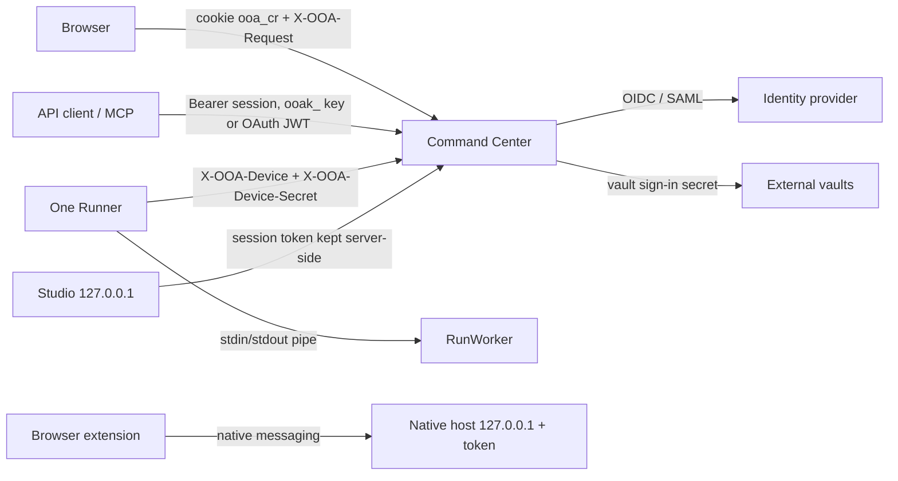

# 06 Security architecture

## What this covers / who it is for

This document describes how ONEOFFICEAUTOMATION protects people's accounts, agents, credentials, run data and the
platform itself: authentication (passwords, single sign-on, two-step sign-in, API keys), permissions and roles, the
vault and its key hierarchy, secret masking in runs and logs, the audit hash chain with checkpoints, transport
security, runner registration and secret rotation, toolkit signing and trusted publishers, the network guard in the
SaaS service, and licence and release signatures. It is for security architects, penetration testers and auditors.
Test cases and known gaps for a formal review are in [../SECURITY_REVIEW.md](../SECURITY_REVIEW.md).

## Contents

1. [Trust boundaries](#1-trust-boundaries)
2. [Authentication](#2-authentication)
3. [Authorization](#3-authorization)
4. [The vault](#4-the-vault)
5. [Secrets during runs](#5-secrets-during-runs)
6. [Audit trail](#6-audit-trail)
7. [Transport and web security](#7-transport-and-web-security)
8. [Runner trust](#8-runner-trust)
9. [Studio and local components](#9-studio-and-local-components)
10. [Supply chain: toolkits, releases, licences](#10-supply-chain-toolkits-releases-licences)
11. [SaaS isolation and the network guard](#11-saas-isolation-and-the-network-guard)
12. [Secure coding rules](#12-secure-coding-rules)
13. [Cryptography summary](#13-cryptography-summary)
14. [Related documents](#related-documents)

---

## 1. Trust boundaries



| Boundary | Credential | Stored as |
| --- | --- | --- |
| Browser to Command Center | Session token in cookie `ooa_cr` (`HttpOnly; SameSite=Strict`, `Secure` over HTTPS) | SHA-256 in `sessions` |
| Program to Command Center | `Authorization: Bearer` with a session token or an `ooak_` API key | SHA-256 in `api_keys` |
| MCP client | API key, session, or an OAuth access token (JWT) from the identity provider | Not stored |
| Runner to Command Center | Device id and secret from registration | SHA-256 in `devices`; clear text in the runner's own config file |
| Runner to run worker | Pipe; secrets sent only on request | Memory only |
| API task caller | `X-OOA-Task-Token` | SHA-256 in `api_tasks` |
| Webhook caller | `X-OOA-Secret` | SHA-256 in `triggers` |

## 2. Authentication

### 2.1 Passwords (`Security`, `ControlRoom.login`)

- PBKDF2-HMAC-SHA256 with 210,000 iterations and a random salt.
- Rules: at least `password_min_length` characters (default 12) with letters and digits, not a common password, not
  the user name; optional history (`password_history`) and maximum age (`password_max_days`).
- Five failed sign-ins lock the account for 15 minutes (`CR.LOCKED_OUT`). An unknown user name still costs a hash
  computation, so timing does not reveal which names exist.
- First sign-in and administrator resets force a change (`must_change`, `CR.PASSWORD_CHANGE_REQUIRED`).
- `ooa reset-admin` recovers a forgotten administrator password with the server stopped; it is audited.

### 2.2 Sessions

- Random tokens; only SHA-256 hashes are stored.
- Sliding expiry of `session_hours` (default 8) on each use.
- At most `max_sessions_per_user` (default 5) at once; the oldest end first.
- `auth/refresh` renews a token; `auth/logout` ends it.

### 2.3 Two-step sign-in (`Mfa`)

- TOTP (RFC 6238: HMAC-SHA1, 30-second steps, one step of drift either way) or a one-time recovery code.
- The TOTP secret is encrypted with the vault key; recovery codes are kept as SHA-256 hashes; a code is accepted once
  (`mfa_last_step`).
- `mfa_required`: 0 optional, 1 required for administrators, 2 required for everyone with a password. SSO users rely on
  their identity provider; API keys are not affected.

### 2.4 Single sign-on

| Protocol | Class | Checks |
| --- | --- | --- |
| OpenID Connect | `Sso` | Authorization code flow with PKCE; ID token signature (RS256/384/512, ES256) against the provider's JWKS; issuer, audience, expiry, nonce |
| SAML 2.0 | `Saml` | HTTP-Redirect out, HTTP-POST back; DTDs and external entities off; exactly one assertion, a direct child of the response; a valid signature by the configured certificate whose single reference points at that element (enveloped and exclusive canonicalisation only, JDK secure validation on); status Success; issuer, audience, recipient, destination; validity window with 2 minutes of skew; `InResponseTo` must match a sign-in this Command Center started; each assertion used once |

New SSO users get `sso_default_role`; when it is empty only existing users may sign in. Encrypted SAML assertions and
sign-ins started at the identity provider are refused. Sign-in state is kept in `auth_pending`, so any cluster node can
complete it.

### 2.5 API keys

- `ooak_` followed by 30 random bytes; shown once; stored as SHA-256; optional expiry up to 730 days; revocable.
- Exchange for a session with `POST /api/auth/token`.
- Rate limits per address apply to unauthenticated routes: 60 per minute for sign-in and registration groups, 1,200 per
  minute for webhooks, API task calls and MCP (`RateLimiter`).

## 3. Authorization

### 3.1 Roles and permissions (`Rbac`)

Every API call checks one permission. Built-in roles:

| Role (code) | Shown as | Permissions |
| --- | --- | --- |
| `viewer` | Viewer | `repo.view`, `runs.view`, `devices.view`, `schedules.view`, `triggers.view`, `globals.view`, `queues.view`, `analytics.view`, `skills.view` |
| `bot_runner` | Agent operator | Viewer plus `runs.start`, `runs.stop`, `queues.work` |
| `bot_creator` | Agent builder | Operator plus `repo.checkin`, `repo.delete`, `schedules.manage`, `triggers.manage`, `lockers.own`, `queues.manage`, `apitasks.manage`, `skills.manage` |
| `admin` | Administrator | Everything (`*`) |

Permissions that only administrators have unless a custom role grants them (`Rbac.ADMIN_ONLY`) include
`repo.production`, `repo.approve`, `repo.permissions`, `lifecycle.export`, `lifecycle.import`, `queues.all`,
`teams.manage`, `users.manage`, `devices.manage`, `lockers.manage`, `globals.manage`, `audit.view`, `pools.manage`,
`settings.manage`, `connections.manage`, `toolkits.manage` and `skills.all`.

- **Custom roles** (`roles` table) combine any permissions. A person can hold several roles (`user_roles`).
- Built-in roles other than `admin` can be switched off (`switched_off_roles`).
- The console hides what a role cannot use, but the server check is what counts.

### 3.2 Folder permissions (`Folders`)

Repository folders can grant roles (`role:`), teams (`team:`) and users (`user:`) one of four levels: **view** (see and
export), **run** (also run and schedule), **edit** (also check out, check in, delete, recover) and **manage** (also set
the live version and labels). The nearest folder with permissions decides; a folder with permissions shuts out
everyone it does not name. Role permissions still apply on top: folder access never grants what the role lacks.

### 3.3 Other scopes

- **Vault folders**: owners, managers, participants and consumers per folder (section 4).
- **Work queues**: owners, participants and consumers (`queue_members`).
- **Model connections**: allowed roles per connection.
- **Production approval**: a version goes live only after someone else with `repo.approve` approves it, when
  `production_approval` is on.

## 4. The vault

### 4.1 Key hierarchy

```
master key (32 bytes, AES-256)
 ├─ source: OOA_MASTER_KEY (Base64) | OOA_MASTER_KEY_SOURCE | master.key in the data folder
 ├─ encrypts: credentials, people's own values, external vault sign-in secrets,
 │            TOTP secrets, the audit chain key, enc: values in config files
 └─ SaaS: the region's master key encrypts each tenant's own 32-byte key (tenants.key_ciphertext)
          and each tenant key encrypts that tenant's vault
```

- `OOA_MASTER_KEY_SOURCE` (`KeySources`) reads the key from `azure-keyvault:https://NAME.vault.azure.net/secrets/S`
  (managed identity or client credentials), `aws-secrets:REGION/SECRET-ID` (environment keys, task role or instance
  role through IMDSv2), `gcp-secret:projects/P/secrets/S/versions/latest` (service account), or `prompt` (an operator
  types it at start). The key lives only in memory.
- Without either variable a random key is written to `master.key` (owner-only permissions where the file system
  supports it). Production installs should use the environment variable or a key source.
- **Rotation** (`VaultAdmin`): every stored value is decrypted with the current key and encrypted with a new one in one
  transaction; the new key is written as `master.key.next` first, then replaces the old one, which is kept as
  `master.key.old-<time>`. Encrypted values in configuration files are re-encrypted too. Not possible from the
  console with `OOA_MASTER_KEY` or a key store; there `ooa vault rekey --new-key-env VAR` (Command Center stopped)
  re-encrypts everything with the new key, and the operator then replaces the key in the variable or store.
- The key fingerprint (first 12 hex digits of its SHA-256) identifies a key without showing it; backup restore checks
  it.

### 4.2 Encryption of values (`Vault`)

AES-256-GCM, a random 12-byte IV per value, 128-bit tag, stored as `v1:<iv>:<ciphertext>`. The value's location
(`folder/credential/attribute`, or that plus the person for personal values) is the GCM associated data, so an
encrypted value copied to another credential fails to decrypt.

### 4.3 Folders and access

- Vault folders (`lockers`) have owners, managers, participants and consumers. Only consumers' runs can read values.
- Values are **never returned to the browser** except a non-masked shared attribute for people who may change it.
  Attributes can be marked **password fields only**: `SecureString.checkPasswordField` refuses to type them anywhere
  else (`VAULT.PASSWORD_ONLY`).
- **User-provided attributes**: each person stores their own value; a run uses the value of its run-as user.
- **External vaults** (`ExternalVaults`): HashiCorp Vault KV v2, Azure Key Vault (client credentials), AWS Secrets
  Manager (Signature V4) and CyberArk CCP. Values are read live at each use with the same permission check and audit;
  the external sign-in secret is itself encrypted in the vault.

## 5. Secrets during runs

1. A job carries **vault references**, never values.
2. When a step needs one, the worker asks its runner, the runner calls `POST /api/agent/credential` with the run id,
   and the Command Center checks that the run is `running` on that runner and that its user (the run-as user when set)
   consumes the folder. **Every read is audited** as `credential.read` with result ok, denied, not_found or failed.
3. The value becomes a `SecureString`: `toString()` is always `****`, `reveal()` is called only when handing it to the
   target system, and `wipe()` clears the memory at the end of the run.
4. The runner adds every revealed value to the run's secret list. `ActionContext.log` and the engine's `log` replace
   any occurrence with `****`; `variable.set` events use a safe representation; the value trail and carried-over
   values never contain credentials.
5. Toolkits may not print to the console (architecture test); they log through `ActionContext`, which redacts.
6. The web goal agent types secrets through `{{secret:name}}` placeholders whose values the model never sees; AI agents
   never expose Credential inputs to the model.

## 6. Audit trail

`Audit` writes an append-only `audit` table:

- Each entry stores `prev_hash` and `hash`. New entries use **HMAC-SHA256** (`alg = h1`) with a 32-byte key created
  once and kept in `settings` encrypted with the vault key, so someone with database access alone cannot rebuild a
  valid chain. Older entries keep plain SHA-256.
- **Checkpoints** every hour: the last sequence number and hash are appended to `audit-checkpoints.log` in the data
  folder and, as an audit entry, sent to the SIEM when syslog forwarding is on.
- **Verify integrity** (`GET /api/audit/verify`) recomputes the chain from the first kept entry, checks that no unkeyed
  entry follows a keyed one, and compares the chain with the checkpoints, which also catches a chain rebuilt by someone
  holding the key.
- **Retention** (`audit_retention_days`): older entries are archived to `audit-archive/*.jsonl.gz` and removed; an
  `audit.purged` entry records the cut so the rest still verifies.
- **Syslog forwarding** (`SyslogForwarder`): RFC 5424 over UDP or TCP (RFC 6587 octet counting), on its own thread with
  a bounded queue; dropped entries are counted.

Everything that changes state is audited, including sign-ins, failed sign-ins, credential reads, run starts and
finishes, licence events, production approvals and settings changes.

## 7. Transport and web security

| Control | Detail |
| --- | --- |
| Built-in HTTPS | `ooa tls configure --pfx`, `ooa tls set-password`, or `ooa tls self-signed`; `HttpsServer` with TLS 1.3 and 1.2 only |
| Behind a proxy | TLS may end at a load balancer that sends `X-Forwarded-Proto: https`; cookies are then marked `Secure` |
| HSTS | `Strict-Transport-Security: max-age=31536000` over HTTPS |
| Content-Security-Policy | `default-src 'self'; img-src 'self' data:; style-src 'self'; script-src 'self'; frame-ancestors 'none'; base-uri 'none'; form-action 'self'` |
| Other headers | `X-Frame-Options: DENY`, `X-Content-Type-Options: nosniff`, `Referrer-Policy: no-referrer`, `Cache-Control: no-store` |
| CSRF | Cookie requests that change anything need `X-OOA-Request: 1`; the cookie is `SameSite=Strict` |
| IP allow list | `ip_allow_list` (CIDR); this computer and health checks always allowed. Checked against the client address: behind a load balancer or reverse proxy listed in `trusted_proxies`, the last `X-Forwarded-For` address that is not a trusted proxy |
| Upload limits | `max_upload_mb`; `block_executable_uploads` refuses executable files (`CR.FILE_TYPE_BLOCKED`) |
| Database TLS | `tls=required` with an optional CA file in `ooa-db.properties` |

## 8. Runner trust

- **Registration**: an administrator creates a one-time registration key (`registration_keys`, valid for the chosen
  hours, used once, optionally for a *temporary* runner such as a VDI desktop). `POST /api/agent/register` returns a
  device id and secret; only the secret's SHA-256 is stored.
- **Requests**: every runner call carries `X-OOA-Device` and `X-OOA-Device-Secret`, compared in constant time. A
  disabled runner is refused.
- **Isolation of runs**: a runner can post events, results and credential requests only for runs assigned to it
  (`runOnDevice`).
- **Secret rotation**: when a secret is older than `runner_secret_days` (default 30) the heartbeat asks the runner to
  call `agent/rotate`; it receives a new secret, and the previous one keeps working for 10 minutes for requests already
  on their way.
- **Temporary runners** that stay offline longer than `temporary_runner_hours` (default 8) are removed.
- **Version rule**: a runner newer than its Command Center gets no work.
- **Certificates**: runners verify the Command Center's certificate using the JDK store, the Windows certificate store
  and an optional CA file (`--ca`); proxy passwords are kept with Windows DPAPI (`dpapi:`), on Linux and macOS in a
  file `proxy-password` next to the runner's config readable by its owner only (`file:PATH`), or read from an
  environment variable (`env:NAME`) (`Network`).
- **Updates**: program files are checked by SHA-256 over the TLS connection before they replace the runner's own
  (`Updater`). They are not separately signed (a known gap).
- **Unattended screens**: dialogs and forms never wait for a person on an unattended run; screen agents do not start on
  a locked runner; after a run the runner can lock the screen or sign out (`DesktopSession`).

## 9. Studio and local components

- Studio binds to **127.0.0.1 only**, refuses non-loopback callers, checks the `Host` header and rejects cross-site
  `Origin` values. Inside `ooa server` it reuses the browser's Command Center sign-in; its Command Center session token
  stays in the Studio process (`ControlRoomLink`), never in the browser.
- Every workspace path goes through `Workspace.resolve`, so nothing outside My Workspace and nothing hidden (such as
  `.trash`) is reachable.
- The browser connector's native host accepts only the extension with the fixed extension id, listens on 127.0.0.1 and
  requires a random token written to `~/.ooa/bridge/<browser>-<pid>.json`.
- Local listeners trust any process on the same computer (known gap).

## 10. Supply chain: toolkits, releases, licences

| Item | Mechanism |
| --- | --- |
| First-party toolkits | `PackageSigning`: Ed25519 signature over a SHA-256 digest of the canonical manifest plus the class bytes. `PackageRegistry.install` refuses unsigned (`PKG.UNSIGNED`), untrusted (`PKG.UNTRUSTED`), not allowed (`PKG.PUBLISHER_NOT_ALLOWED`), modified (`PKG.TAMPERED`) or badly signed (`PKG.BAD_SIGNATURE`) toolkits. Development builds sign with a key generated at start |
| Custom toolkits | Signed jars with `META-INF/ooa-toolkit.json`; administrators trust a publisher's Ed25519 public key (`toolkit_publishers`); upload checks signature, digest, id and version; each jar loads in its own class loader; the runner checks hash and signature again (see [07-toolkit-architecture.md](07-toolkit-architecture.md)) |
| Release files | `ooa release sign` writes a manifest of file names, sizes and SHA-256, signed with the vendor's Ed25519 key; `ooa release verify` checks a download with the public key built into the product |
| SBOM | CycloneDX `sbom.cdx.json` in every package |
| Licences | JSON `{format: ooa-license-1, payload, signature}`, Ed25519-signed with the vendor key; public key `License.VENDOR_PUBLIC_KEY`; optional `install_id` binding; tampering gives `LICENSE.INVALID` |
| Template catalogue | Vendor feed signed with the vendor key; a feed with a bad signature is refused as a whole |
| Agent versions | SHA-256 of each checked-in version is re-checked on read; Lifecycle bundles carry per-agent checksums and a checksum over the list |

## 11. SaaS isolation and the network guard

- Each tenant has its own **schema**, **data folder** and **vault key** (see
  [09-multi-tenant-saas-and-regions.md](09-multi-tenant-saas-and-regions.md)).
- `NetGuard`: for a tenant, every address the server itself connects to (mail, syslog, external vaults, identity
  provider, trigger sources, callbacks, promotion targets, Git remote) must be public. Loopback, private, link-local
  (cloud metadata), carrier-grade NAT, unique-local and multicast addresses are refused with `SAAS.ADDRESS_BLOCKED`.
  The name is resolved before the check and again when connecting, so the region's network must also block these
  ranges (egress rules).
- No tenant code runs in the server: custom toolkit upload is refused (`SAAS.NOT_AVAILABLE`), and serverless runs are
  off unless the region allows them.
- An unknown and a suspended tenant both answer 404, so addresses do not reveal which tenants exist.

## 12. Secure coding rules

Enforced by `ArchitectureTest` and code review:

- SQL only with `?` placeholders.
- No shell execution; processes start with argument lists.
- XML only through `XmlSupport` (external entities blocked).
- Toolkits never print; they log through `ActionContext`.
- Secret inputs use `OoaType.CREDENTIAL`; stored secrets are never returned to the browser.
- Expressions are evaluated by an allow-listed function table with no reflection.

## 13. Cryptography summary

| Use | Algorithm |
| --- | --- |
| Password hashing | PBKDF2-HMAC-SHA256, 210,000 iterations |
| Tokens, keys, secrets at rest | SHA-256 hashes; constant-time comparison |
| Vault values | AES-256-GCM with associated data |
| Audit chain | HMAC-SHA256 (keyed) or SHA-256 (legacy) |
| TOTP | HMAC-SHA1 (RFC 6238) |
| Toolkit, licence, release and catalogue signatures | Ed25519 |
| SSO token checks | RSA (RS256/384/512), ECDSA (ES256), XML-DSig for SAML |
| Cloud request signing | AWS Signature V4 (HMAC-SHA256) |
| Randomness | `SecureRandom` |

All of it uses the JDK; there is no third-party crypto library.

## Related documents

- [README.md](README.md)
- [01-system-overview.md](01-system-overview.md)
- [02-components-and-modules.md](02-components-and-modules.md)
- [03-agent-model-and-runner.md](03-agent-model-and-runner.md)
- [04-command-center-internals.md](04-command-center-internals.md)
- [05-data-model.md](05-data-model.md)
- [07-toolkit-architecture.md](07-toolkit-architecture.md)
- [08-ai-architecture.md](08-ai-architecture.md)
- [09-multi-tenant-saas-and-regions.md](09-multi-tenant-saas-and-regions.md)
- [10-extensibility-and-integration.md](10-extensibility-and-integration.md)
- [../SECURITY_REVIEW.md](../SECURITY_REVIEW.md), [../LICENSING.md](../LICENSING.md)
