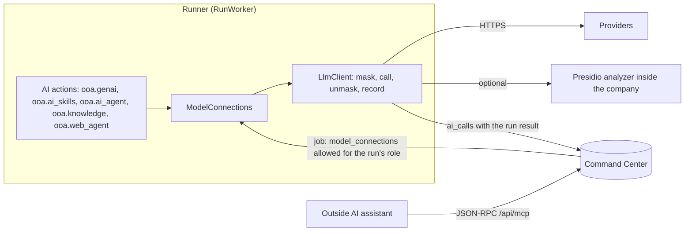

# 08 AI architecture

## What this covers / who it is for

This document describes how ONEOFFICEAUTOMATION uses language models: the provider-neutral model client, model
connections and where they come from, governance (allowed roles, budgets and limits, masking of personal data, content
checks, records of every call), the AI toolkits (Generative AI, Prompt Skills, AI agents, the web goal agent, Knowledge
Q&A), Studio's AI assistant, and the MCP server through which outside AI assistants run agents. It is for architects,
risk and compliance reviewers, and developers adding providers or AI features.

## Contents

1. [Overview](#1-overview)
2. [The model client](#2-the-model-client)
3. [Model connections](#3-model-connections)
4. [Governance](#4-governance)
5. [Generative AI actions](#5-generative-ai-actions)
6. [Prompt Skills](#6-prompt-skills)
7. [AI agents](#7-ai-agents)
8. [Web goal agent](#8-web-goal-agent)
9. [Knowledge Q&A](#9-knowledge-qa)
10. [Studio AI assistant](#10-studio-ai-assistant)
11. [MCP server](#11-mcp-server)
12. [Human review of AI output](#12-human-review-of-ai-output)
13. [Adding a provider](#13-adding-a-provider)
14. [Related documents](#related-documents)

---

## 1. Overview

Model calls happen **on the runner** (or in Studio, or in a serverless run), not in the Command Center. The Command
Center decides which connections a run may use, sends their settings with the job, and stores the governance records
the run sends back.

## 2. The model client

`LlmClient` (module `packages`) speaks one neutral message format and translates it per provider:

| Provider value | Service |
| --- | --- |
| `openai` | OpenAI |
| `azure_openai` | Azure OpenAI |
| `anthropic` | Anthropic |
| `openai_compatible` | Any OpenAI-compatible endpoint (LiteLLM, vLLM, Ollama and others) |
| `huggingface` | Hugging Face Inference Providers router (`https://router.huggingface.co/v1`) or a self-hosted TGI server |
| `aws_bedrock_sagemaker` | A model on an Amazon SageMaker real-time endpoint, signed with AWS Signature V4 |
| `aws_bedrock` | Amazon Bedrock Converse API, signed with AWS Signature V4 |
| `google_vertex` | Google Vertex AI (Gemini), with a service-account key or an access token |

- Messages: `[{role: system|user|assistant|tool, content, tool_calls?, tool_call_id?, name?}]`; content is text or
  parts (`{"type": "text"}`, `{"type": "image", "media_type", "data"}`).
- Tools: `[{name, description, input_schema}]`.
- Options (temperature, top-p, top-k for Anthropic, penalties, seed and others) are sent only when set, so each provider
  keeps its defaults.
- JSON answers are parsed tolerantly (code fences allowed).
- `AiBridge` gives toolkits in other modules (the web goal agent) the same client, masking and records.
- `ModelProbe` tests a connection with one tiny request ("Answer with OK"); the key is used for that request only.

## 3. Model connections

A **model connection** is a named set of provider, model, endpoint and key reference that AI actions, Prompt Skills
and AI agents use by name (`ModelConnections`).

| Source | Where | Notes |
| --- | --- | --- |
| Command Center | `model_connections` table; Administration > Model Connections; `GET/PUT/DELETE /api/connections`, `POST /api/connections/test` | Key as a vault reference (`key_ref`); `allowed_roles`; `model_type`; budgets and limits; PII analyzer; content check |
| Workspace (Studio, local runs) | `model-connections.json` | `{"default": "gpt", "connections": [{name, provider, model, api_key_env}]}` or `api_key: {"$credential": ...}`; keys are never stored in the file |

When a run is claimed, the Command Center sends only the connections that the run user's roles may use
(`platform.connectionsForJob`). A connection whose monthly token budget is used up is sent as **blocked**, so calls
through it fail with the reason. Values set directly on an action win over the named connection.

## 4. Governance

| Control | Where enforced | Detail |
| --- | --- | --- |
| Who may use a connection | Command Center, at job time | `allowed_roles` per connection |
| Monthly token budget | Command Center | `monthly_tokens`; counted from `ai_calls`; an exhausted connection goes to the runner as blocked |
| Calls per run | Runner (`ModelConnections.beforeCall`) | `calls_per_run`; beyond it `AI.CALL_LIMIT` |
| Calls per minute | Runner | `calls_per_minute`, counted per run and connection; the call waits (up to a minute) instead of failing |
| Personal data masking | Runner (`LlmClient`) | Before every call (unless switched off on the action): built-in patterns for e-mail addresses, IBANs, credit card numbers, US social security numbers, IP addresses and phone numbers are replaced by typed tokens and restored in the answer. With `pii_analyzer_url` set, a Microsoft Presidio analyzer inside the company also finds names, places and IDs in many languages |
| Content check | Runner | `content_check: moderation` runs the provider's moderation check on answers (OpenAI and OpenAI-compatible endpoints); a flagged answer fails the step |
| Records of every call | Runner → Command Center | Who, which run and agent, purpose, provider, model, connection, input and output tokens, latency, what was masked, which tools were called, and a SHA-256 fingerprint of the prompt. **Never the prompt or answer text.** Studio writes the same records to `ai-governance.jsonl` in the workspace; runners send them with the run result and the Command Center stores them in `ai_calls` before marking the run finished |
| Review | Command Center | AI governance page (`GET /api/governance?days=30`) and per-run AI calls (`GET /api/runs/{id}/ai-calls`); retention `ai_call_retention_days` |
| Approval of sensitive tools | Runner | See AI agents |

## 5. Generative AI actions

`ooa.genai` (version 1.1.0) offers single-purpose actions, all with `capabilities` network and ai:

`prompt`, `chat` and `end_chat` (multi-turn sessions), `prompt_with_images`, `generate_image`, `summarize`, `classify`,
`extract` (fields to JSON), `translate`, `sentiment`, `detect_language`, `key_phrases`, `entities`.

Each takes a connection name (or provider settings), optional sampling options and a masking switch, and returns text
or structured values plus token counts.

## 6. Prompt Skills

A Prompt Skill is a reviewed, reusable prompt template: `{system, prompt, connection, output, temperature, inputs}`.

- In the Command Center (`PromptSkills`, tables `prompt_skills` and `prompt_skill_versions`): every save is a new
  version; a skill is private to its owner until shared; templates are starting points people copy
  (`skills/templates`, `skills/from-template`).
- In a workspace: `ai-skills/*.json`.
- `ooa.ai_skills/run` runs a skill by name with inputs; `ooa.ai_skills/list` lists them.
- A job carries the skills its agents name (shared ones and the owner's private ones); these win over a workspace file
  of the same name.

## 7. AI agents

`ooa.ai_agent/run` (timeout 1,800 s) lets a model reason toward a goal and call **published agents as tools**:

| Input | Meaning |
| --- | --- |
| `goal`, `instructions` | What to achieve and how to behave |
| `tools` | The agents the model may call (only these) |
| `sensitive_tools` | Agents that need a person's approval before each call |
| `provider` / `connection` | The model to use |

Outputs: `answer`, `status`, `outputs`, `trace` (the steps taken) and `tokens`.

Guardrails in `AiAgentPackage`:

- Tool arguments are checked against each agent's declared input variables; unknown or missing arguments are returned
  to the model as an error to correct.
- Credential inputs are never exposed to the model.
- Step and token limits stop runaway loops: `max_steps` (default 8 model turns), `max_tokens_total` (default 60,000)
  and `max_duration_seconds`; reaching a limit returns status `limit_reached`.
- A sensitive tool asks the person at the desktop; no answer within `ooa.approval.timeoutSeconds` (default 300) counts
  as no, and headless or unattended runs are denied at once.
- Tool calls run as child agents through the `bot_invoker` service, so they appear in the run's events and every model
  call is in the governance records.

The Python reference also has an `Agent` flow kind with its own runtime, approvals and MCP server
(`reference/ooa/agents`); in the Java platform AI agents are expressed with this action.

## 8. Web goal agent

`ooa.web_agent` (module `packages-browser`) works a web page toward a goal given in plain words:

- `start_session` / `end_session` open and close the browser session; `run` ("Reach a goal") works for up to 1,800 s.
- Each turn the model sees the page's address, title, visible text and numbered controls, never password values or
  vault secrets, and answers with one tool: click, type, select, scroll, go to an address, go back, wait or finish.
- Secrets are typed through `{{secret:name}}` placeholders; the model never sees their values.
- An allow list of sites keeps the agent on the sites named.
- Model access goes through `AiBridge`, so masking and governance records apply.

## 9. Knowledge Q&A

`ooa.knowledge` answers questions from a company's own documents:

| Action | Behaviour |
| --- | --- |
| `build_index` | Splits text, Markdown, HTML, CSV, JSON, XML, Word (.docx, .doc, .rtf), PowerPoint and PDF files into passages and writes one index file, with embeddings when a model is given. Old Office formats and PDF use the Office and PDF toolkits when the runner has them |
| `search` | Finds the best passages: by words (BM25) always, and by meaning too when the index has embeddings |
| `ask` | Answers from those passages only, citing them, and says so when they do not hold the answer |

The index is a plain file, so it can be stored as a repository file and sent with the runs that need it
(`requires.files`).

## 10. Studio AI assistant

`POST /studio/api/assistant/build` drafts or extends an agent from a description. Studio builds a compact catalogue of
every action from the manifests (`toolkit/action | name | inputs (required marked) | outputs`), adds the current agent,
and asks the chosen model connection for one JSON object `{variables, steps, notes}` in the Flow format. The result is
validated like any agent before it is shown, and the person decides what to keep. Because the catalogue comes from the
manifests, new toolkits are known to the assistant without code changes.

The **desktop assistant** (`ooa assistant`) is not a language model feature: it is the notification-area app that
starts agents for the signed-in person (with their API key, kept with Windows DPAPI) and shows task and run notices.

## 11. MCP server

`McpServer` implements the Model Context Protocol (protocol version `2025-06-18`) over HTTP: JSON-RPC 2.0 on
`POST /api/mcp`.

| Method | Behaviour |
| --- | --- |
| `initialize` | Server info "ONEOFFICEAUTOMATION One CommandCenter" |
| `ping` | Empty result |
| `tools/list` | The agents an administrator exposed (setting `mcp_agents`) that the caller may run; tool names from paths (`Finance/Invoice worker.flow.json` → `Finance_Invoice_worker`); input schemas from the agents' input variables (Number → number, Boolean → boolean, List/Table → array, Dictionary/Record → object, others → string) |
| `tools/call` | Starts a normal run (source `mcp`) as the calling user on the runner or pool in `mcp_runner` (or any online runner), waits up to `mcp_timeout_seconds` (default 120) and returns the outputs |

- Authentication: an API key (`ooak_`), a session token, or an **OAuth access token** (JWT) from the configured
  identity provider. For OAuth the Command Center publishes `/.well-known/oauth-protected-resource` (RFC 9728) with
  `mcp_oauth_audience` and `mcp_oauth_scope`, and a 401 on `/api/mcp` carries a `WWW-Authenticate` header pointing
  there.
- Every call uses the user's role, folder permissions and vault access, appears in Agent Activity and is audited.
- MCP calls share the "calls" rate-limit group (1,200 per minute per address).

## 12. Human review of AI output

- **Document automations** (`*.doc.json` in Studio) describe the fields to extract and generate an AI extraction agent.
- When an agent run from a work queue returns `validation.fields`, the item waits in status `review`; a person checks
  and corrects the fields (`validateItem`), and the item returns to the queue with the validated values.
- **Test sets** (`TestSets`) score AI agents with tolerant expectations (`contains`, `matches`, `approx` with tolerance,
  `one_of`, `not_empty`).

## 13. Adding a provider

1. Add a branch in `LlmClient` for the request format and response parsing (and signing, if needed).
2. Add the provider value to the enumerations of the AI toolkits (`GenAiPackage`, `AiAgentPackage`, `AiSkillsPackage`),
   to `Platform.PROVIDERS`, to Studio's provider list (`StudioServer` and `AI_PROVIDERS` in `studio.js`).
3. Make sure masking, content checks and governance records work through the shared path.
4. Test against a local fake server.

## Related documents

- [README.md](README.md)
- [01-system-overview.md](01-system-overview.md)
- [02-components-and-modules.md](02-components-and-modules.md)
- [03-agent-model-and-runner.md](03-agent-model-and-runner.md)
- [04-command-center-internals.md](04-command-center-internals.md)
- [05-data-model.md](05-data-model.md) – `model_connections`, `ai_calls`, `prompt_skills`
- [06-security-architecture.md](06-security-architecture.md)
- [07-toolkit-architecture.md](07-toolkit-architecture.md)
- [09-multi-tenant-saas-and-regions.md](09-multi-tenant-saas-and-regions.md)
- [10-extensibility-and-integration.md](10-extensibility-and-integration.md) – MCP and REST integration
