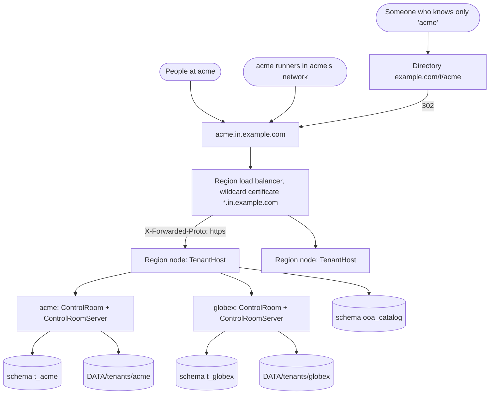

# 09 Multi-tenant SaaS and regions

## What this covers / who it is for

This document describes how ONEOFFICEAUTOMATION runs as a hosted, multi-tenant service in several regions: what a
region and a tenant are, how a tenant's data is isolated (schema, folder and key per tenant), how requests are routed
by host name, the operator API and commands, the optional global directory that maps names to regions, multi-node
regions, the restrictions that apply to tenants, licensing by seats, and the limits of this version. It is for the
architects and operators of the service and for customers' security teams assessing it. Step-by-step operating
instructions are in [../SAAS.md](../infrastructure/09-saas-and-multi-region-operations.md); on-premises installs are not affected by anything here.

## Contents

1. [Concepts](#1-concepts)
2. [Architecture](#2-architecture)
3. [Isolation model](#3-isolation-model)
4. [Request routing](#4-request-routing)
5. [Tenant lifecycle and the operator API](#5-tenant-lifecycle-and-the-operator-api)
6. [Region configuration](#6-region-configuration)
7. [The global directory](#7-the-global-directory)
8. [Several nodes per region](#8-several-nodes-per-region)
9. [What is different for a tenant](#9-what-is-different-for-a-tenant)
10. [Shared templates](#10-shared-templates)
11. [Licensing, backups and limits](#11-licensing-backups-and-limits)
12. [Related documents](#related-documents)

---

## 1. Concepts

| Term | Meaning | Code |
| --- | --- | --- |
| Region | One deployment (for example India `in`, US `us`, EU `eu`): its nodes, its PostgreSQL database and its storage. A tenant's data never leaves its region | `ooa region start`, `RegionConfig` |
| Tenant | One customer: its own database schema `t_<id>`, data folder `DATA/tenants/<id>` and vault key | `Tenants`, `Tenants.Tenant` |
| Catalog | Schema `ooa_catalog`: each tenant's address name, company name, status, seats, admin e-mail and encrypted key; the region's shared templates | `Tenants` |
| Address name (slug) | The tenant's part of the host name: `acme` in `acme.in.example.com` | `Tenants.SLUG` |
| Router | One web server per region node that hands each request to the tenant named by the host | `TenantHost` |
| Directory | Optional global service: address name → region, nothing else | `RegionDirectory`, `ooa directory start` |
| Operator | The service provider's staff, who create and manage tenants | operator token |

The platform is cloud-neutral: containers and PostgreSQL, nothing provider-specific.

## 2. Architecture

Each tenant runs **the same Command Center code** as an on-premises install (`ControlRoom` and
`ControlRoomServer.forTenant`), with its own users, agents, runners, vault, schedules, audit trail, backups and
background clock (thread `ooa-cr-clock-<tenant>`). The region process holds one such Command Center per active tenant.

## 3. Isolation model

| Layer | How tenants are separated |
| --- | --- |
| Database | One PostgreSQL schema per tenant (`Db.inSchema("t_<id>", 3)`); every connection of the tenant's pool is bound to that schema, so a query without a tenant filter still sees only that tenant's tables. SQL Server is not supported for tenants |
| Files | `DATA/tenants/<id>` for repository files, backups, audit checkpoints and other data-folder content; the backup and repository-file folder settings cannot be changed by a tenant |
| Secrets | Each tenant has its own 32-byte vault key, stored in `tenants.key_ciphertext` encrypted with the region's master key (`OOA_MASTER_KEY` or `OOA_MASTER_KEY_SOURCE`). Losing the region key loses every tenant's vault |
| Toolkits | A toolkit registry per tenant (`Supplier<PackageRegistry>`), so trust decisions stay per tenant; uploads of custom toolkits are refused in SaaS |
| Network | `NetGuard` refuses private and internal destinations for every connection the server makes on a tenant's behalf (section 9) |
| Runners | Customers' runners stay in their own networks and connect out to their tenant's address; registration keys and device secrets are per tenant |
| Addresses | An unknown and a suspended tenant both answer 404 |

`TenantIsolationTest` checks isolation with two tenants that use the same user names, agent paths, runner names and
credential names.

## 4. Request routing

`TenantHost` serves every tenant of the region on one port:

1. It reads the `Host` header. `acme.<domain>` is tenant `acme`; the region's own address (and an IP address or
   `localhost`, used by internal load balancers) is the region itself; any other host is not of this region.
2. A request for an active tenant is handed to that tenant's `ControlRoomServer`, opening its Command Center on first
   use if it is not open yet.
3. The region's own address answers only `/healthz` (and `/api/health`) and, when the operator token is configured, the
   operator API.
4. TLS ends at the load balancer or ingress with a wildcard certificate for `*.<domain>`; it must send
   `X-Forwarded-Proto: https` so cookies are marked `Secure` and HSTS is sent.
5. One request-size limit applies to all tenants of the region.

Housekeeping in `TenantHost`: database connections of tenants unused for 10 minutes are closed and reopened on the next
request; tenants suspended or deleted on another node stop on this node too (within 30 seconds).

## 5. Tenant lifecycle and the operator API

The operator API is on the region's own address and requires the operator token (its SHA-256 is in the region
settings; without it the API is off). It never answers on a tenant's address.

| Request | Command | Effect |
| --- | --- | --- |
| `GET /api/operator/tenants` | `ooa region tenant list` | The tenants |
| `POST /api/operator/tenants` `{slug, name, admin_email, seats}` | `ooa region tenant create --slug acme --name "Acme Ltd" --admin-email ... --seats developer=2,unattended_runner=5` | Reserves the name in the directory (if any), creates the schema with all Command Center tables, the folder, the key and the first administrator; returns the tenant address and the administrator's one-time password (shown once) |
| `POST /api/operator/tenants/NAME/seats` | `ooa region tenant seats NAME --seats ...` | Changes the seats |
| `POST /api/operator/tenants/NAME/suspend` | `ooa region tenant suspend NAME` | Refuses the tenant's people and runners (404), stops its schedules and triggers; data stays |
| `POST /api/operator/tenants/NAME/resume` | `ooa region tenant resume NAME` | Starts it again |
| `DELETE /api/operator/tenants/NAME` | `ooa region tenant delete NAME` | Only a suspended tenant: drops its schema, removes its folder and catalog entry with its key, releases the name in the directory |
| `GET /api/operator/templates[?status=pending]` | `ooa region template list` | Shared templates |
| `POST /api/operator/templates/ID/approve` / `reject` | `ooa region template approve|reject ID` | Review a shared template |

The CLI commands take `--url https://<region-domain>` and `--token-env VAR` (the token is read from an environment
variable, never typed on the command line). `ooa region token` prints a new random token and its SHA-256.

Address names are 3 to 40 lower-case letters, digits and hyphens, starting with a letter and not ending with a hyphen
(`^[a-z][a-z0-9-]{1,38}[a-z0-9]$`). Reserved: `www`, `api`, `admin`, `app`, `ooa`, `status`, `mail`, `login`, `auth`,
`support`, `docs`, `static`, `region`.

After creation the customer's administrator signs in with the one-time password, chooses a new one, and sets up
users, single sign-on and runners as on premises.

## 6. Region configuration

`DATA/config/ooa-region.properties` (`RegionConfig`); secrets are never in the file, only the names of environment
variables:

| Key | Meaning |
| --- | --- |
| `region` | Short name, for example `in` |
| `domain` | `in.example.com`; tenants are `<slug>.in.example.com` |
| `db.url`, `db.user`, `db.password_env` | The region's PostgreSQL (an account that may create schemas). Without `db.url`, H2 in the data folder (tests only) |
| `operator.token_sha256` | Enables the operator API |
| `directory.url`, `directory.token_env` | The global directory and this region's token, when there are several regions |
| `serverless` | `true` only once the region's network blocks private addresses for the nodes |

In a container the same settings come from `OOA_REGION`, `OOA_DOMAIN`, `OOA_DB_URL`, `OOA_DB_USER`, `OOA_DB_PASSWORD`,
`OOA_OPERATOR_TOKEN_SHA256`, `OOA_DIRECTORY_URL`, `OOA_DIRECTORY_TOKEN` and `OOA_SERVERLESS`. `docker/compose.saas.yaml`
starts one region with PostgreSQL for a trial. Start a region with `ooa region start --data DATA --port 8720`.

## 7. The global directory

With several regions, `ooa directory start` runs a small service (`RegionDirectory`, its own database with one table
`directory (slug, region, created)`):

| Route | Purpose |
| --- | --- |
| `GET /t/NAME` | 302 to `https://NAME.<region-domain>/` |
| `GET /api/directory/NAME` | `{slug, region, url}` |
| `POST /api/directory/NAME` | A region reserves NAME (`Authorization: Bearer <region token>`; 409 when another region holds it) |
| `DELETE /api/directory/NAME` | A region releases one of its names |

`DATA/config/ooa-directory.properties` lists each region's `domain` and the SHA-256 of its token. The directory holds no
customer data. A region reserves a name before creating a tenant, so each name exists in one region only. A tenant does
not move between regions; to move one, export it, create it in the other region and restore the export there.

## 8. Several nodes per region

- Run more nodes with the same settings and database behind the load balancer. The tenants' data folders
  (`DATA/tenants`) must be on shared storage (NFS, Azure Files, EFS, Filestore).
- Each tenant's background work runs on one node at a time through that tenant's own leader lease (`Cluster`, table
  `cluster_lease` in the tenant's schema).
- A node opens every active tenant's Command Center at start so schedules and triggers run, and keeps up to 3 database
  connections per tenant (the catalog uses 4). With more than a few hundred tenants per region, put PgBouncer in session
  mode in front of PostgreSQL.
- `/healthz` answers `{"status":"ok"}` for load balancers and container checks, also without a host name.

## 9. What is different for a tenant

| Area | On premises | SaaS tenant |
| --- | --- | --- |
| Outgoing connections from the server (mail, syslog, external vaults, identity provider, trigger sources, run callbacks, promotion targets, Git remote) | Any address | Public addresses only; loopback, private, link-local (cloud metadata), carrier-grade NAT, unique-local and multicast are refused with `SAAS.ADDRESS_BLOCKED`; the Git remote must be `https://` or SSH |
| Custom toolkit upload | Allowed | Refused (`SAAS.NOT_AVAILABLE`); custom code runs only on customers' runners |
| Serverless Agent APIs | Allowed | Only when the region sets `serverless=true` |
| Backup folder and repository-file folder | Configurable | Fixed to the tenant's folder |
| Outbound proxy setting | Applied (process-wide) | Ignored; the region's network decides |
| Licence | Signed licence file | Seats from the operator; licence files refused |
| Systems inside the customer's network | Reachable from the server | Reached through a runner in that network |

Because the address check resolves the name and the connection resolves it again, the region's **egress rules** must
also block `10.0.0.0/8`, `172.16.0.0/12`, `192.168.0.0/16`, `100.64.0.0/10`, `169.254.0.0/16`, `127.0.0.0/8`,
`fc00::/7` and `fe80::/10` (except the region's own database and storage), for example with a Kubernetes NetworkPolicy
or cloud security groups.

## 10. Shared templates

A tenant can offer one of its agents to the other tenants of the region (Build > Templates > Share an agent;
`POST /api/templates/share`). The bundle (the agent and the agents it calls, never credentials or values) is stored in
`ooa_catalog.shared_templates` with status `pending`. An operator reviews and approves or rejects it; once approved,
every tenant of the region sees it in its catalogue and can install it. Rejecting an approved template withdraws it from
the catalogue; installed copies stay.

## 11. Licensing, backups and limits

- **Licensing**: tenants have no licence files. The operator sets seats (`developer`, `citizen_developer`,
  `attended_runner`, `unattended_runner`) at creation and changes them later; no seats given means no limit. The
  tenant's licence state is `subscription`: free seats go to people and runners on first use.
- **Backups**: back up the region's PostgreSQL (all schemas, with point-in-time recovery) and the data folder, and keep
  the master key apart. A tenant's administrator can make backups in Administration > Backups (into the tenant's folder)
  and download them as an export.
- **Limits of this version**: no self-service sign-up or billing; a tenant stays in its region; restoring one tenant
  from its own backup is not built (restore the region database, or the tenant's schema with PostgreSQL tools); custom
  toolkits run only on customers' runners.

## Related documents

- [README.md](README.md)
- [01-system-overview.md](01-system-overview.md) – deployment shapes
- [02-components-and-modules.md](02-components-and-modules.md)
- [03-agent-model-and-runner.md](03-agent-model-and-runner.md)
- [04-command-center-internals.md](04-command-center-internals.md) – clustering and serverless runs
- [05-data-model.md](05-data-model.md) – catalog and tenant schemas
- [06-security-architecture.md](06-security-architecture.md) – key hierarchy and network guard
- [07-toolkit-architecture.md](07-toolkit-architecture.md)
- [08-ai-architecture.md](08-ai-architecture.md)
- [10-extensibility-and-integration.md](10-extensibility-and-integration.md)
- Operator guide: [../SAAS.md](../infrastructure/09-saas-and-multi-region-operations.md)
